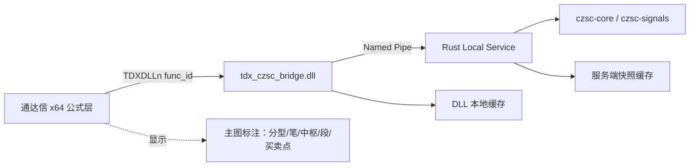

<div align="center">

# tdx_czsc

**通达信 x64 缠论自动标注系统** · *Chan-theory auto-labeling for TongDaXin (TDX)*

让通达信原生支持缠论：分型、笔、中枢、段、买卖点自动计算并在主图标注。

基于 **Rust `czsc-core` 分析服务** · **x64 C++ Bridge DLL** · **Windows Named Pipe IPC** · **通达信公式层显示**

[](LICENSE)
[](#快速开始-quick-start)
[](#仓库结构-repository-layout)
[](#项目状态--roadmap)

</div>

---

## 目录

- [项目简介](#项目简介)
- [特性 Features](#特性-features)
- [架构 Architecture](#架构-architecture)
- [快速开始 Quick Start](#快速开始-quick-start)
- [通道说明 Channels](#通道说明-channels)
- [仓库结构 Repository Layout](#仓库结构-repository-layout)
- [测试 Testing](#测试-testing)
- [性能 Performance](#性能-performance)
- [项目状态 & Roadmap](#项目状态--roadmap)
- [文档 Documentation](#文档-documentation)
- [参与贡献 Contributing](#参与贡献-contributing)
- [许可证 License](#许可证-license)
- [免责声明 Disclaimer](#免责声明-disclaimer)

---

## 项目简介

`tdx_czsc` 的目标不是重写缠论算法，而是把成熟的 Rust `czsc` 生态接入 **通达信 x64**，形成一套**本地运行、可调试、可扩展**的缠论自动标注方案：



**设计原则**

- **算法在服务端**：缠论计算全部由 Rust 服务承担，通达信公式层只做显示；
- **协议先行**：`proto/analysis.proto` 是通道/消息的唯一事实来源，DLL 与服务的接口以它为准；
- **结果稳定可回归**：真实行情 CSV 驱动的回归测试覆盖通道值与绘制规则。

---

## 特性 Features

- ✅ **分型 / 笔**：顶底分型、笔端点与笔方向通道（101/102/201/202）
- ✅ **段（线段）**：特征序列分型法识别段（203/204）
- ✅ **中枢**：原生 `czsc-core` 贪心归属 + 前端/后端优化（301~304）
  - 前端：中枢第一笔与行情趋势相反（上升行情首笔下、下跌行情首笔上），行情方向按中枢高低位置判定；
  - 后端：中枢最后一笔与趋势相反（奇数笔结构），末笔与趋势同向的离开笔剔除；
  - 相邻间隔：前一个中枢后端与后一中枢前端至少间隔一笔，**前端优化优先于后端**；
- ✅ **买卖点**：接入 `czsc-signals`（401~406，一买/一卖标准信号 + 二/三类均线辅助），
  含锚点对齐、信号去重与三买/三卖按中枢严格化
- ✅ **单遍演化（P0）**：结构+信号共用一次逐 bar 演化并复用同一 `CZSC`，
  消除"信号演化 + 结构 `CZSC::new`"的双重全量扫描（实测全量约 2 倍提速）
- ✅ **增量更新（P0b）**：服务端缓存演化状态（CZSC + 信号评估器），
  窗口首部稳定时（全量窗口增长 / 盘中末笔原地更新）稳态刷新只演化新增
  K 线（新增数百根约 10ms 级、同序列缓存命中约 10µs）；固定尾窗口平移
  等不适用场景自动回退全量，输出位级一致
- ✅ **全量覆盖（P0c）**：默认 `analysis_window=0` 即全量——通达信传入的
  全部 K 线参与分析（前方历史不再空白），`max_bi_num` 默认 1000（对齐
  czsc Python 默认），全量历史笔数不再被旧 50 上限截断；配合增量缓存
  稳态维护（滚动/缩放零重算，历史区域始终有完整结构标注）
- ✅ **量能背驰**：950 量能输入通道融合真实 VOL；未挂载时自动以振幅代理量兜底
- ✅ **Windows 全链路**：Named Pipe 服务 + 自动拉起/退出回收（Job Object）+ 冒烟测试
- ✅ **公式模板**：结构主图模板 `tdx_formula_examples/main_chart_full.tn6`
  （分型/笔/中枢/段）+ 买卖点专家系统指示 `tdx_formula_examples/buy_sell_expert.tn6`
  （401~406 → ENTERLONG/EXITLONG 买卖信号，可回测；B/S 箭头由系统绘制，
  类型文字标注见 `buy_sell_mark.tn6`）
- ✅ **ATR 止盈止损模板**：`tdx_formula_examples/atr_tp_sl.tn6`（一买/二买/三买
  各自独立成段、互不合并：每类买点各画一对 ATR 动态止盈/止损线，可同时并存；
  K 线穿线即终止该类线的绘画；仅 4 个参数，含影子回归测试）
- ✅ **缠论选股公式**：`tdx_formula_examples/chan_select.tn6`（条件选股公式：
  30 分钟级别买点 + 无卖点 + 信号放量 + 日线向上确认的多周期联立口径）

---

## 架构 Architecture

### 各层职责

| 层 | 职责 |
|---|---|
| **通达信公式层** | 调用 `TDXDLLn(func_id, HIGH, LOW, CLOSE)`，只负责图形显示，不承担算法计算 |
| **Bridge DLL（x64 C++）** | 导出 `RegisterTdxFunc`；按 `func_id` 路由到输出通道；维护 DLL 本地缓存（默认 16 条）；经 Named Pipe 请求 Rust 服务；服务未运行时自动拉起 `tdx_czsc_service.exe` |
| **Rust Service** | 接收结构化请求 → 构造 `RawBar` → 调用 `czsc-core`/`czsc-signals` → 输出 `AnalysisSnapshot`；管理服务级快照缓存（64 条）与同数据段并发合并（singleflight） |

### 输入约定

通达信公式当前按以下方式传参：

```text
TDXDLL1(func_id, HIGH, LOW, CLOSE)
```

- 第 1 路输入：`HIGH`
- 第 2 路输入：`LOW`
- 第 3 路输入：`CLOSE`

> 通达信 DLL ABI 只有 3 路 `float[]` 输入 + 1 路 `float[]` 输出，复杂缠论对象因此降维为**多通道输出**（见下方通道表）。

---

## 快速开始 Quick Start

### 前置要求

| 组件 | 版本要求 |
|---|---|
| 操作系统 | **Windows x64**（DLL 集成）；Rust 服务部分可跨平台开发 |
| Rust | stable（`rust_service/Cargo.toml`，edition 2024） |
| `protoc` | 需在 PATH（或设 `PROTOC` 环境变量，`build.rs` 生成协议） |
| CMake + MSVC | x64 工具链（构建 Bridge DLL） |
| vcpkg | 提供 protobuf C++ 运行时；依赖与版本声明在 `bridge_dll/vcpkg.json` |
| 通达信 | x64 版本（验证显示） |

### 1. 构建与运行 Rust 服务

```powershell
cd rust_service
cargo run            # 启动 Named Pipe 服务（默认管道 \\.\pipe\tdx_czsc_analyzer）
```

macOS/Linux 下同样可 `cargo check` / `cargo test`（服务端逻辑），仅 DLL 联调必须 Windows。

### 2. 构建 Bridge DLL 并跑冒烟测试

```powershell
cd bridge_dll
# vcpkg 依赖（protobuf 版本固定在 vcpkg.json）由 CMake toolchain 自动安装到 build\vcpkg_installed
cmake -S . -B build -A x64 -DCMAKE_TOOLCHAIN_FILE="$env:VCPKG_INSTALLATION_ROOT\scripts\buildsystems\vcpkg.cmake"
cmake --build build --config Release
build\Release\tdx_czsc_ipc_smoke_test.exe   # 先跑控制台 IPC 测试
```

### 3. 部署到通达信

```powershell
.\deploy_to_tdx.bat            # 默认部署到 D:\new_tdx64；可传参：.\deploy_to_tdx.bat D:\new_tdx64
```

脚本自动完成：① `cargo build --release`；② cmake 构建 DLL；③ 拷贝
`tdx_czsc_bridge.dll`（含 `libprotobuf.dll`、`abseil_dll.dll` 运行时）与
`tdx_czsc_service.exe` 到 `<通达信安装目录>/T0002/dlls/`。

**服务生命周期（自动）**：DLL 检测到管道不存在时自动拉起同目录的
`tdx_czsc_service.exe`（日志 `tdx_czsc_service.log`）；通达信退出（含崩溃）时
由 Job Object（`KILL_ON_JOB_CLOSE`）自动终止服务——无需手动启停。服务 exe 路径
可用 `bridge_dll/tdx_czsc_bridge.ini.example` 或环境变量 `TDX_CZSC_SERVICE_EXE` 覆盖。

### 4. 通达信公式模板

在通达信中加载 `tdx_formula_examples/main_chart_full.tn6`（结构主图模板：
分型/笔/中枢/段标注；买卖点已剥离为独立脚本），切换到带量能的周期数据即可
看到标注结果。

> **换机必做**：先按 `Ctrl+D → 设置3` 勾选“主图指标不影响坐标的高低值”，
> 否则主图公式中的 0 值会参与坐标缩放，导致 K 线整体上移并被压缩。
> 完整部署与排障步骤见 [`docs/使用说明.md`](docs/使用说明.md)。

买卖点专家系统指示：新建"交易系统"（专家系统）公式并导入
`tdx_formula_examples/buy_sell_expert.tn6`，叠加到主图后，一买/二买/三买处
自动标注 B 箭头（买入指示 ENTERLONG），一卖/二卖/三卖处标注 S 箭头（卖出
指示 EXITLONG），并可在通达信"系统指示/回测"功能中使用；公式内含 950 量能
通道调用，恢复一买/一卖的真实量能背驰维度。注意：专家系统公式**不允许使用
绘图函数**（否则报"TDXSTEPxx 不是指定的输出名"错误），B/S 箭头由通达信自动
绘制；如需 `'一买'/'一卖'` 等类型文字标注，再以"技术指标/主图叠加"导入
`tdx_formula_examples/buy_sell_mark.tn6` 配合使用。

> 量能提示：`buy_sell_expert.tn6` 已内置量能通道调用（`TDXDLL1(950, HIGH,
> LOW, VOL)` 放在 401~406 之前），恢复一买/一卖的真实量能背驰维度；
> `atr_tp_sl.tn6` 未挂载量能通道时，服务端自动以振幅代理量兜底（可经配置关闭）。

买点 ATR 动态止盈止损模板：加载 `tdx_formula_examples/atr_tp_sl.tn6`（主图叠加，
依赖 401/403/405 买点通道）。**一买/二买/三买各自独立成段**，每类买点从自己的
锚点起画一对 ATR 动态线、互不合并，三条止盈线三条止损线可同时并存：

- 动态止损线（吊灯式，**价格下方**，下穿离场）：`HHV(高 - K1×ATR, 买入以来)`，
  随新高上移；
- 动态止盈线（目标价式，**价格上方**，上穿离场）：`HHV(前高 + K2×ATR, 买入以来)`
  （前高 = 买入以来最高、不含当前 K 线），随每次创新高跳升上移、只升不降。

K 线上穿止盈线或下穿止损线即终止该买点的线（不输出文字/图标；买入 bar 自身不参与
穿线判定，保证线从买入处可见），同类新买点出现后重开新段；**只画止盈止损线，
不含缠论结构线**；参数仅 4 个（ATR 周期/止损倍数/止盈倍数/触发方式），改数字
即可调整。

仅日线显示（单脚本周期限定）：`tdx_formula_examples/atr_sl_day.tn6` 内置
`PERIOD` 周期门控，**只在日线周期显示止损线，分钟/周/月等其他周期自动不显示**
（输出 DRAWNULL；注意 PERIOD 的日线编码因通达信版本而异，默认按 5=日线，
不一致时先输出 PERIOD 验证再改）。若需分钟周期直接使用日线结果画线，因通达信
跨周期引用必须引用独立公式，需自行按"日线源公式 + 分钟引用公式"双脚本模式扩展。

缠论选股公式：以"条件选股公式"导入 `tdx_formula_examples/chan_select.tn6`，
选股器（`ctrl+T`）中**周期选 30 分钟**执行。口径（多周期联立）：
① 最近 5 个交易日（参数 `回看:=40` 根 30 分钟 K 线）内出现缠论买点（一买/二买/
三买）；② 窗口期内无卖点；③ 窗口内买点信号当日放量（VOL > 前 5 根均量 ×
`放量系数:=1.2`）；④ **日线向上确认**：日线收盘高于上一交易日且高于 5 个交易日
前（`CLOSE#DAY` 跨周期引用）。真机首跑前确认两验证项：选股器批量执行时 DLL
通道正常返回、`#DAY` 跨周期引用可用（不可用时公式内有后备写法注释）。

---

## 通道说明 Channels

`func_id` 与通道的一一映射（单一来源：`rust_service/src/analyzer/channels.rs`，
协议定义见 `proto/analysis.proto`）：

| func_id | 通道名 | 说明 |
|---:|---|---|
| 101 | `fx_top` | 顶分型（分型极值K线处输出价格） |
| 102 | `fx_bottom` | 底分型 |
| 201 | `bi_points` | 笔端点（起止分型价格） |
| 202 | `bi_direction` | 笔方向（覆盖区间 ±1） |
| 203 | `seg_points` | 段端点（仅已确认段） |
| 204 | `seg_direction` | 段方向（段覆盖区间 ±1） |
| 301 | `zs_upper` | 中枢上沿 |
| 302 | `zs_lower` | 中枢下沿 |
| 303 | `zs_middle` | 中枢中轴 |
| 304 | `zs_boundary` | 中枢左右界标记（1=左界、2=右界、3=左右界共用） |
| 401~406 | `buy1`…`sell3` | 一买/一卖/二买/二卖/三买/三卖 |
| 901 | `debug_cache_hit` | 调试：缓存命中（1/0） |
| 902 | `debug_service_ready` | 调试：服务就绪（恒 1） |
| 903 | `debug_latency_ms` | 调试：最近一次请求耗时 |
| 950 | `vol_input` | **量能输入通道**（只上传 VOL，不发起分析） |

---

## 仓库结构 Repository Layout

```text
tdx_czsc/
├── proto/
│   └── analysis.proto          # 协议唯一事实来源（prost-build 生成 Rust 绑定）
├── rust_service/               # Rust 分析服务
│   ├── src/
│   │   ├── analyzer/           # 分型/笔/中枢/段/买卖点 + 通道映射（纯逻辑，无运行时依赖）
│   │   ├── handlers/           # 信封分发、分析协调（缓存/单飞）、调试通道
│   │   ├── cache/  state/  config/  ipc/   # 运行期支撑
│   │   └── main.rs
│   ├── examples/analyze_csv.rs # 离线 CSV 分析工具（脱离通达信验证算法）
│   └── tests/                  # 真实数据回归测试（通路/段/中枢/信号/背驰）
├── bridge_dll/                 # x64 C++ DLL（通达信加载）+ 冒烟测试 + ini 样例
├── tdx_formula_examples/       # 通达信公式模板（main_chart_full / atr_tp_sl / atr_sl_day / buy_sell_expert / buy_sell_mark / chan_select）
├── tests/data/                 # 回归测试真实行情 CSV
├── docs/                       # 技术方案 + 通达信 DLL 编程规范
├── deploy_to_tdx.bat           # 一键部署：构建服务与 DLL 并拷贝到通达信
├── CONTRIBUTING.md
└── LICENSE                     # MIT
```

---

## 测试 Testing

```powershell
cd rust_service
cargo test                       # 单元 + 集成回归（真实行情数据）
cargo test -- --nocapture        # 需要观察通道明细/性能剖面时
cargo clippy --all-targets -- -D warnings   # 质量门
cargo fmt -- --check
```

回归测试使用仓库内真实行情（`tests/data/*.csv`）分别覆盖：

- 通道值与绘制规则（中枢边界、首末笔方向、相邻间隔）
- 段识别规则（特征序列分型、连续性、方向校验）
- 买卖点锚点与去重、三买/三卖按中枢严格化
- 一买/一卖量能背驰（合成行情 + 代理量路径）

离线算法验证（不依赖通达信）：

```powershell
cd rust_service
cargo run --example analyze_csv -- ../tests/data/002340_day.csv 6
```

---

## 性能 Performance

**Release 实测**（`analyze_csv`，单请求全量分析，`max_bi_num=1000`）：

| 场景 | 耗时 |
|---|---|
| 420 根 30 分钟（全量） | 约 13ms |
| 3933 根日线（全量，min_bi_len=6 默认 → 332 笔） | 单遍演化 75ms / 快照总 **170ms** |
| 3933 根日线（全量，min_bi_len=3 → 笔数 >1000 顶格） | 快照总约 258ms |
| 增量承接（全量窗口 + 新增数百根） | 约 5~10ms |
| 同序列缓存命中（滚动/缩放/重复刷新） | 约 10µs |

> P1 信号评估热路径：`cxt_second/third_bs` 重实现（O(N) 映射 → O(log N)
> 二分 + 增量 MA，`analyzer/signals_fast.rs`），信号评估 227.5ms → 51.3ms、
> 全量快照总耗时 523ms → 170ms（3.1×），输出与优化前逐条一致（对照测试
> `signals_fast_parity` + 信号回归锁定）。
> 全量覆盖 3933 根后笔数从旧上限 50 提升至实际 332（min_bi_len=6），
> 历史买卖点（本例 index=59 起 ~89 个信号）完整保留；`max_bi_num=1000`
> 是 czsc 硬上限，超短线周期（1 分钟线等）下早期笔仍会被清理，
> 可按需调大 `TDX_CZSC_MAX_BI_NUM`。

**链路吞吐设计**：通达信每轮刷新对同一数据段约 19 次 `TDXDLLn` 调用，仅首个未命中
缓存的请求触发一次 IPC 分析，其余命中 DLL 本地快照缓存（默认 16 条）；服务端
另有快照缓存（64 条）与**同数据段并发合并**（singleflight）、全量分析并发上限
`analysis_parallelism`（默认 4，多窗口/多标的场景可调大）。
开启增量（服务端默认）后，全量窗口的后续刷新只演化新增 K 线并重装请求通道
（实测 002340：新增 200~300 根约 5~10ms、同序列缓存命中约 10µs；
3933 根首建全量约 170ms，之后滚动/缩放零重算）。

**关键参数**（DLL 侧，优先级：环境变量 `TDX_CZSC_*` > `tdx_czsc_bridge.ini` > 内置默认）：

- `TDX_CZSC_REQUEST_TIMEOUT_MS`（默认 3000）：单次请求读写超时；
- `TDX_CZSC_CACHE_CAPACITY`（默认 16）：DLL 本地快照缓存条数；
- `TDX_CZSC_MAX_BI_NUM` / `TDX_CZSC_MIN_BI_LEN` / `TDX_CZSC_ANALYSIS_WINDOW`：
  分析参数（默认 1000/6/**0**；`0` = 全量，即分析通达信传入的全部 K 线）。

**服务端参数**（`tdx_czsc_service.ini`，与 exe 同目录，可选；不存在时用内置
默认；环境变量 `TDX_CZSC_*` 优先级最高，样例见
`rust_service/tdx_czsc_service.ini.example`）：

- `analysis_parallelism`（默认 4）：全量分析并发上限；
- `enable_incremental`（默认 true）/ `incremental_cache_capacity`（默认 8）：
  增量分析与状态缓存；
- `cache_capacity`（默认 64）：服务端快照缓存条数；
- `derive_volume_proxy`（默认 true）：量能代理兜底开关；
- `max_bi_num` / `min_bi_len` / `analysis_window`：请求缺省时的兜底值
  （正常流程 DLL 每请求都会下发这三个值，覆盖此处）。

---

## 项目状态 & Roadmap

**状态：原型 / 首轮联调阶段**

- 2026-08-17：Windows x64 真机全链路联调通过（Rust 服务 / bridge_dll / 冒烟测试 / 通达信公式显示）
- 2026-08-30：P0~P1 真机验证通过（单遍演化 / 增量分析 / 全量演进 / 信号评估热路径：
  历史区域全部标注、滚动零重算、全量快照 170ms 级）

**近期规划**

- [ ] 安装与分发方案（当前 DLL 依赖 `libprotobuf.dll` / `abseil_dll.dll` 两个运行时，目标静态链接或自带运行时）
- [ ] 多周期分析（跨周期中枢/背驰）
- [x] 增量更新（P0b：缓存 CZSC+信号评估器，窗口首部稳定时稳态仅演化新增 K 线）
- [x] 全量演进（P0c：默认 `analysis_window=0` 全量覆盖 + `max_bi_num=1000` 不再截断历史笔）
- [ ] 图形表达增强（通达信公式层）

---

## 文档 Documentation

| 文档 | 内容 |
|---|---|
| [`docs/使用说明.md`](docs/使用说明.md) | 部署、通达信系统设置、公式导入、日常使用与常见问题 |
| [`docs/技术方案_通达信缠论自动标注系统.md`](docs/技术方案_通达信缠论自动标注系统.md) | 总体方案：协议、通道设计、中枢/段绘制规则、配置与验收 |
| [`docs/通达信DLL函数编程规范/`](docs/通达信DLL函数编程规范) | 通达信官方 DLL 编程规范与示例插件（**第三方材料，版权归官方**，见目录内 README） |
| [`CHANGELOG.md`](CHANGELOG.md) | 版本变更记录 |
| [`SECURITY.md`](SECURITY.md) | 漏洞报告与安全注意事项 |
| [`CONTRIBUTING.md`](CONTRIBUTING.md) | 贡献指南与 Rust 代码结构约定 |

---

## 参与贡献 Contributing

欢迎围绕以下方向贡献：

- Rust 服务完善（通道映射、算法规则、性能）
- Windows x64 Bridge DLL 完善
- 通达信联调验证与公式模板优化
- 文档与排障资料补充

请先阅读 [`CONTRIBUTING.md`](CONTRIBUTING.md)（含模块职责表、错误分层与抽象门槛约定）。

---

## 许可证 License

本项目采用 [MIT License](LICENSE)（Copyright © 2026 chainta）。

---

## 免责声明 Disclaimer

本项目用于技术研究、工程验证与本地集成实验，**不构成任何投资建议**。缠论标注结果
仅供参考，据此交易风险自负。
