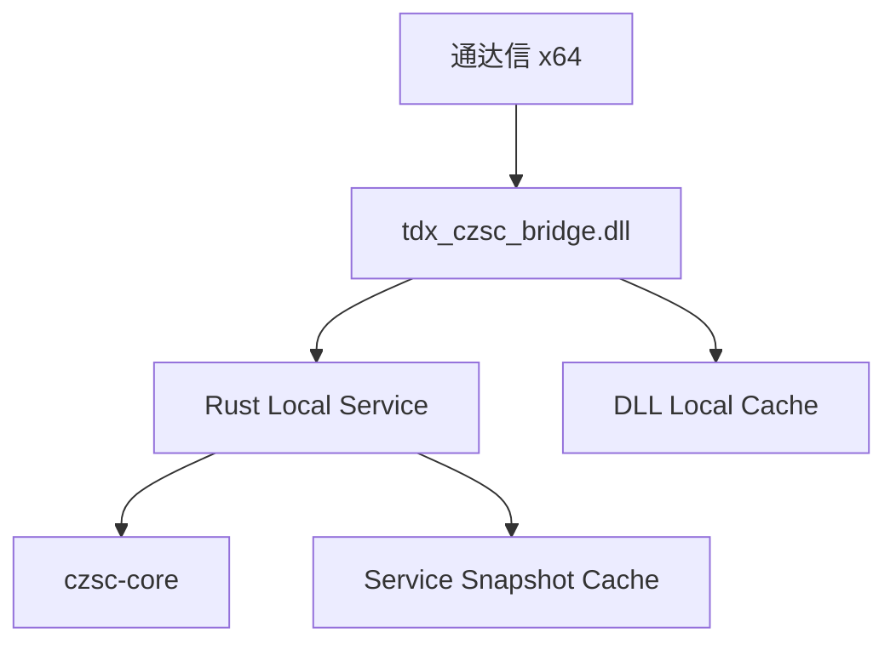

# tdx_czsc

> 通达信 x64 + Rust `czsc-core` + x64 C++ Bridge DLL 的本地缠论自动标注系统原型

`tdx_czsc` 的目标不是重写缠论算法，而是把成熟的 Rust `czsc` 能力接入 **通达信 x64**，形成一套：

- 本地运行
- 可调试
- 可扩展
- 面向通达信公式系统的缠论自动标注方案

当前技术栈：

- **算法核心**：[`waditu/czsc`](https://github.com/waditu/czsc) / `czsc-core`
- **分析服务**：Rust
- **桥接层**：x64 C++ DLL
- **IPC**：Windows Named Pipe
- **展示层**：通达信公式 + `TDXDLLn(...)`

---

## 特性概览

当前仓库已实现/具备：

- `analysis.proto` 协议定义
- Rust 本地分析服务骨架
- `czsc-core` 真实接入
- `czsc-signals` 买卖点信号接入（401~406 一买一卖 / 二类 / 三类）
- 基础结构通道输出
- x64 Bridge DLL 工程骨架
- C++ protobuf + Named Pipe 客户端骨架（OVERLAPPED 超时 + 连接重试）
- DLL 本地缓存、日志与可配置策略（环境变量 / `tdx_czsc_bridge.ini`）
- Windows 控制台 `ipc_smoke_test`
- 通达信公式示例模板
- Windows 构建、联调、排障、checklist 文档

当前已完成的部分包括：

- Windows x64 真机全链路联调（Rust 服务 / bridge_dll / ipc_smoke_test / 通达信公式显示）—— **2026-08-17 首轮联调通过**
- 401~406 买卖点信号通道（接入 `czsc-signals`，一买/一卖为标准信号，二/三类为均线辅助判定；2026-08-17 实现）

当前还未完成的部分主要包括：

- 安装与分发方案（当前 DLL 依赖 `libprotobuf.dll` / `abseil_dll.dll` 两个运行时）

> **项目状态：原型 / 首轮联调已通过**

---

## 整体架构



### 各层职责

#### 通达信公式层
- 调用 `TDXDLLn(func_id, HIGH, LOW, CLOSE)`
- 负责图形显示
- 不承担缠论算法计算

#### x64 Bridge DLL
- 导出 `RegisterTdxFunc`
- 接收 3 路 `float[]` 输入
- 将不同 `func_id` 路由为不同输出通道
- 维护 DLL 本地缓存
- 通过 Named Pipe 请求 Rust 服务
- 将结果回填为通达信可识别的 `float[]`

#### Rust Service
- 接收结构化请求
- 构造 `RawBar`
- 调用 `czsc-core`
- 输出 `AnalysisSnapshot`
- 管理服务级缓存与调试信息

---

## 当前已实现的通道

| func_id | 通道名 | 说明 |
|---:|---|---|
| 101 | `fx_top` | 顶分型 |
| 102 | `fx_bottom` | 底分型 |
| 201 | `bi_points` | 笔端点 |
| 202 | `bi_direction` | 笔方向 |
| 203 | `seg_points` | 段端点（段首笔起点/末笔终点分型价格） |
| 204 | `seg_direction` | 段方向（段覆盖区间 ±1） |
| 301 | `zs_upper` | 中枢上沿 |
| 302 | `zs_lower` | 中枢下沿 |
| 303 | `zs_middle` | 中枢中轴 |
| 401 | `buy1` | 一买（czsc-signals `cxt_first_buy`） |
| 402 | `sell1` | 一卖（czsc-signals `cxt_first_sell`） |
| 403 | `buy2` | 二买（czsc-signals `cxt_second_bs` 均线辅助） |
| 404 | `sell2` | 二卖（czsc-signals `cxt_second_bs` 均线辅助） |
| 405 | `buy3` | 三买（czsc-signals `cxt_third_bs` 均线辅助） |
| 406 | `sell3` | 三卖（czsc-signals `cxt_third_bs` 均线辅助） |
| 901 | `debug_cache_hit` | 缓存命中调试 |
| 902 | `debug_service_ready` | 服务存活调试 |
| 903 | `debug_latency_ms` | 最近一次耗时调试 |

### 当前输入约定

通达信公式当前按以下方式传参：

```text
TDXDLL1(func_id, HIGH, LOW, CLOSE)
```

即：

- 第 1 路输入：`HIGH`
- 第 2 路输入：`LOW`
- 第 3 路输入：`CLOSE`

---

## 仓库结构

```text
tdx_czsc/
├── README.md
├── CONTRIBUTING.md
├── .gitignore
├── proto/
│   └── analysis.proto
├── rust_service/
│   ├── Cargo.toml
│   ├── build.rs
│   └── src/
├── bridge_dll/
│   ├── CMakeLists.txt
│   ├── include/
│   ├── src/
│   ├── tests/
│   └── logs/
├── deploy_to_tdx.bat        ← 一键部署：构建服务与 DLL 并拷贝到通达信
├── tdx_formula_examples/
│   ├── debug_ready.tn6
│   ├── debug_latency.tn6
│   ├── cache_hit_debug.tn6
│   ├── fx_marks.tn6
│   ├── bi_points.tn6
│   ├── zs_band.tn6
│   └── main_chart_combo.tn6
└── docs/
    ├── index.md
    ├── 技术方案_通达信缠论自动标注系统.md
    ├── 开发环境说明_Mac与Windows.md
    ├── Windows构建前置条件.md
    ├── Windows首轮联调步骤.md
    ├── Windows实际联调排错清单.md
    ├── Windows联调执行Checklist.md
    ├── 通达信公式联调说明.md
    └── 开源许可证选择建议.md
```

---

## 快速开始

### 1. 先看文档
如果你是第一次进入仓库，建议阅读顺序：

1. `docs/index.md`
2. `docs/技术方案_通达信缠论自动标注系统.md`
3. `docs/开发环境说明_Mac与Windows.md`
4. `docs/Windows构建前置条件.md`

### 2. Rust 服务
目录：

- `rust_service/`

当前 `build.rs` 使用 `prost-build` 编译 `proto/analysis.proto`，因此需要本机可用的 `protoc`。

#### macOS
```bash
brew install protobuf
cargo check --manifest-path rust_service/Cargo.toml
```

如果 `protoc` 不在 PATH，可显式指定：

```bash
PROTOC=/path/to/protoc cargo check --manifest-path rust_service/Cargo.toml
```

### 3. Windows x64 首轮联调
建议顺序：

#### 启动 Rust 服务
```powershell
cd rust_service
cargo run
```

#### 构建 Bridge DLL 与测试程序
```powershell
cd bridge_dll
cmake -S . -B build -A x64
cmake --build build --config Release
```

#### 先跑控制台 IPC 测试
```powershell
cd build\Release
./tdx_czsc_ipc_smoke_test.exe
```

> 联调期手动启动服务后跑 smoke test；**发布部署后不需要手动启动**——smoke test 与通达信都会在检测到服务未运行时自动拉起 `tdx_czsc_service.exe`（见下）。

#### 再进入通达信
确认 `ipc_smoke_test` 跑通后，运行**根目录一键部署脚本**（自动构建服务与 DLL 并拷贝到通达信）：

```powershell
.\deploy_to_tdx.bat          # 默认 D:\new_tdx64；也可指定: .\deploy_to_tdx.bat D:\new_tdx64
```

脚本做三件事：① `cargo build --release` 构建 Rust 服务；② `cmake` 构建 bridge DLL；③ 拷贝 `tdx_czsc_bridge.dll`（含 `libprotobuf.dll`、`abseil_dll.dll` 两个运行时依赖）和 `tdx_czsc_service.exe` 到 `<通达信安装目录>/T0002/dlls/`。

**服务生命周期（自动）**：DLL 检测到服务未运行（管道不存在）时自动拉起同目录的 `tdx_czsc_service.exe`（日志写 `tdx_czsc_service.log`）；通达信退出（含崩溃）时服务由 Job Object（`KILL_ON_JOB_CLOSE`）自动终止——无需手动启停。服务 exe 路径可用 `tdx_czsc_bridge.ini`（样例见 `bridge_dll/tdx_czsc_bridge.ini.example`）或环境变量 `TDX_CZSC_SERVICE_EXE` 覆盖。

最后在通达信中：

---

## 通达信公式模板

目录：

- `tdx_formula_examples/`

建议联调顺序：

1. `debug_ready.tn6`
2. `debug_latency.tn6`
3. `cache_hit_debug.tn6`
4. `fx_marks.tn6`
5. `bi_points.tn6`
6. `zs_band.tn6`
7. `buy_sell_points.tn6`
8. `main_chart_combo.tn6`（精简综合版）
9. `main_chart_full.tn6`（完整综合版）

详细说明见：

- `docs/通达信公式联调说明.md`

---

## 开发环境说明

### Mac 上适合做什么
当前可以在 macOS 上优先推进：

- 协议设计
- Rust 服务开发
- `czsc-core` 接入
- 通道映射
- 文档整理
- C++ Bridge DLL 骨架编写

### Windows 上必须做什么
以下内容必须在 Windows x64 环境真实验证：

- Bridge DLL 编译
- Protobuf C++ 生成与链接
- Win32 Named Pipe 联调
- 通达信 x64 加载 DLL
- 通达信公式显示验证

详细见：

- `docs/开发环境说明_Mac与Windows.md`

---

## 文档导航

### 总体方案
- `docs/技术方案_通达信缠论自动标注系统.md`

### 环境与构建
- `docs/开发环境说明_Mac与Windows.md`
- `docs/Windows构建前置条件.md`

### 联调步骤
- `docs/Windows首轮联调步骤.md`
- `docs/Windows联调执行Checklist.md`

### 排障
- `docs/Windows实际联调排错清单.md`

### 公式联调
- `docs/通达信公式联调说明.md`

### 贡献与仓库维护
- `CONTRIBUTING.md`
- `docs/开源许可证选择建议.md`

---

## 当前已知限制

1. 通达信 DLL ABI 天然限制为：
   - 3 路输入 `float[]`
   - 1 路输出 `float[]`
2. 复杂缠论对象必须降维为多个通道输出
3. 最终图形表达能力仍受通达信公式系统限制
4. 当前仓库处于原型验证阶段；2026-08-17 已通过 Windows x64 真机首轮全链路联调（见 `docs/Windows实际联调排错清单.md` 的联调记录）

---

## 开源许可证说明

本项目当前采用：

- **MIT License**

许可证文件见：

- `LICENSE`

如果你想了解为什么当前选择 MIT，以及其他许可证（如 Apache-2.0 / GPL-3.0）的取舍，可参考：

- `docs/开源许可证选择建议.md`

---

## 贡献

欢迎围绕以下方向贡献：

- Rust 服务完善
- Windows x64 Bridge DLL 完善
- 通达信联调验证
- 公式模板优化
- 文档和排障资料补充

请先阅读：

- `CONTRIBUTING.md`

---

## 免责声明

本项目当前用于技术研究、工程验证与本地集成实验，不构成任何投资建议。
