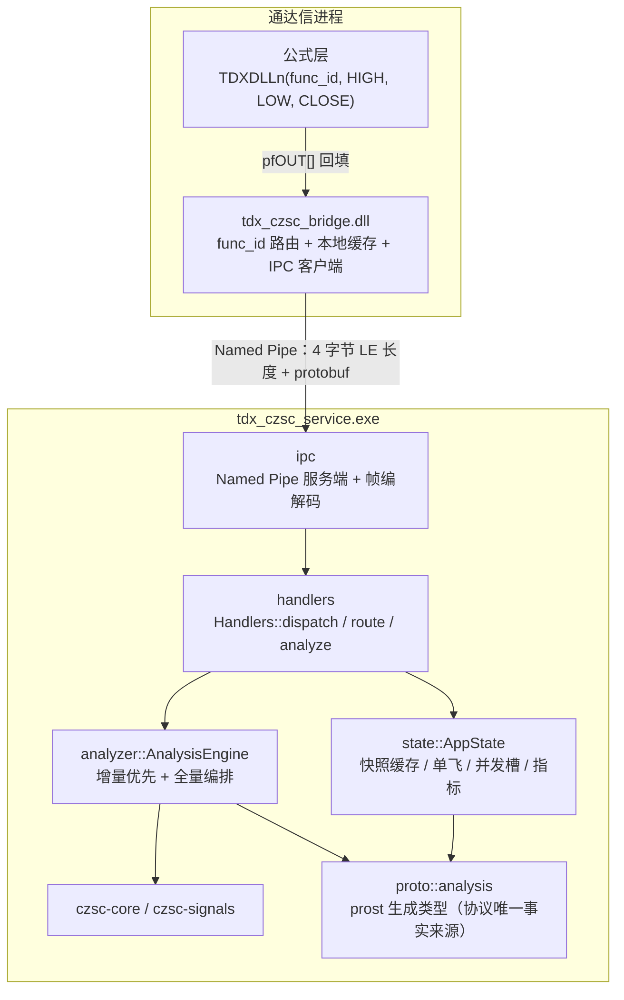
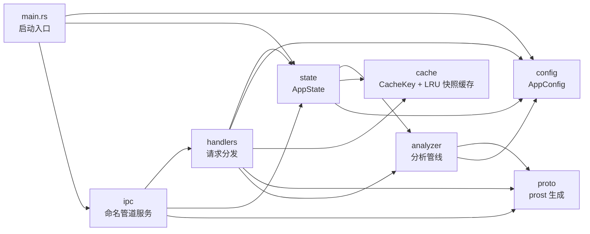
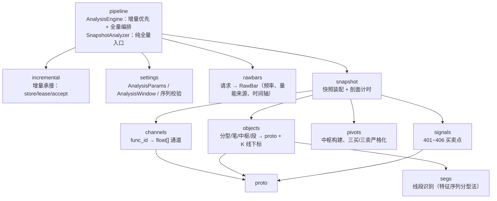
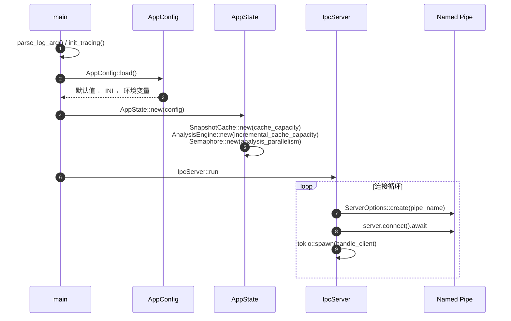
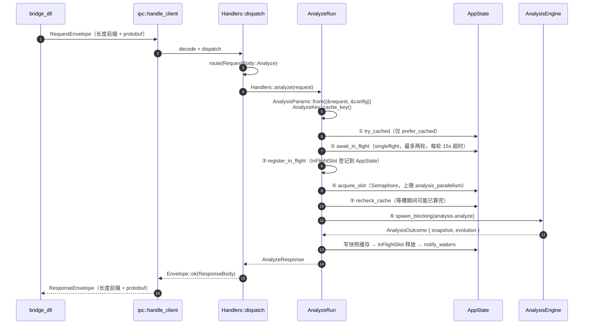
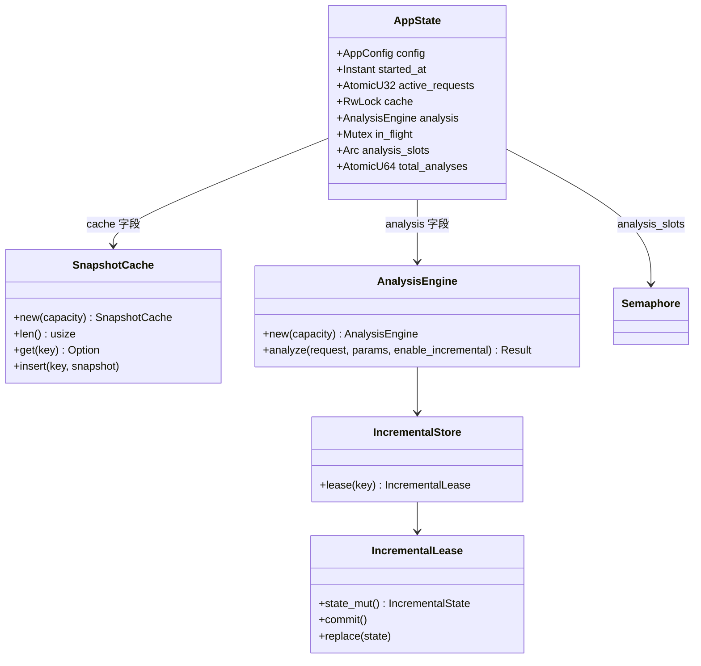
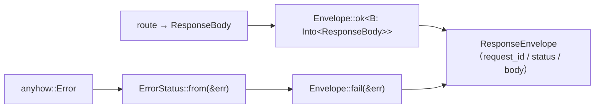

# rust_service 架构图

本文只描述 **Rust 服务内部**的模块划分、调用链与并发/缓存结构；跨进程的三层职责（公式层 / Bridge DLL / Rust 服务）见
[`技术方案_通达信缠论自动标注系统.md`](技术方案_通达信缠论自动标注系统.md) 第 2 章。

> 图基于 `rust_service/src` 当前实现绘制，模块名与函数名均可直接在代码中检索。

---

## 1. 进程与分层

- **进程边界**：DLL 与服务各自独立进程，仅通过命名管道通信；管道名为 `AppConfig::pipe_name`
  （默认 `\\.\pipe\tdx_czsc_analyzer`）。
- **帧格式**：`read_frame` / `write_frame` 均为「u32 小端长度 + protobuf payload」，与 `bridge_dll` 侧一致。
- **proto 是唯一契约**：`proto/analysis.proto` 由 `rust_service/build.rs` 的 prost-build 生成到 `proto::analysis`，
  请求/响应/通道/快照类型全部来自这里，服务内部不再重复定义数据结构。

---

## 2. 模块依赖

箭头表示「依赖方向」（A → B：A 使用 B）。`analyzer` 只向下依赖 `proto` / `config`，不反向依赖 `handlers`。

| 模块 | 职责 | 对外主要类型 |
|---|---|---|
| `main` | 解析 `--log`、初始化 tracing、装配 `AppConfig` / `AppState`、启动 IPC | — |
| `ipc` | 命名管道监听、连接循环、帧读写 | `IpcServer` |
| `handlers` | 请求分发、响应封装、错误映射、分析编排（缓存 / 单飞 / 并发槽） | `Handlers` |
| `state` | 进程级共享状态：配置、快照缓存、在途表、信号量、计数 | `AppState` |
| `analyzer` | 请求 → `RawBar` → CZSC → 中枢/段/买卖点 → 通道与对象 → 快照 | `AnalysisEngine`、`SnapshotAnalyzer`、`AnalysisParams` |
| `cache` | 服务端快照缓存键与 LRU 容器 | `CacheKey`、`SnapshotCache` |
| `config` | 默认值 → INI → `TDX_CZSC_*` 环境变量的三层合并 | `AppConfig` |
| `proto` | 协议生成代码（禁手改） | `RequestEnvelope`、`ResponseEnvelope`、`AnalysisSnapshot` |

### 2.1 analyzer 子模块

- `pipeline` 是唯一入口：决定本次走**增量**还是**全量**，两条路径产出同一个 `AnalysisOutcome`，
  保证输出一致。
- `channels` 只负责把已算好的结构映射成定长 `float[]`，不做算法判断。

---

## 3. 启动与管道服务

- 非 Windows 主机上 `IpcServer::run` 直接返回「named pipe server is only supported on Windows hosts」，
  因此 macOS/Linux 只能跑 `cargo check` / `cargo test`，不能起服务。
- 单连接处理是「读一帧 → 解码 → 分发 → 编码 → 写一帧 → flush」的同步回合，连接级并发由 `spawn` 提供。

---

## 4. 一次 analyze 请求的主链路

| 阶段 | 命中条件 | 命中后行为 | 是否占并发槽 |
|---|---|---|---|
| ① `try_cached` | `prefer_cached=true` 且缓存命中 | 直接回填，`CacheState::Hit` | 否 |
| ② `await_in_flight` | 同 `CacheKey` 已有在途分析 | 等 `Notify` 后重查缓存 | 否 |
| ③ `register_in_flight` | 总会执行 | 登记 `CacheKey → Notify` | 否 |
| ④ `acquire_slot` | 总会执行 | 阻塞直到拿到信号量 | 取得后占用 |
| ⑤ `recheck_cache` | 等槽期间结果已落缓存 | 直接回填，`CacheState::Miss`（未真正计算） | 立即释放 |
| ⑥ `compute` | 未命中以上全部 | 阻塞线程池全量/增量分析 | 占用至完成 |

**关键不变量**

1. 先写缓存、再唤醒等待者：`InFlightSlot` 的释放顺序保证等待方醒来时缓存必然可命中。
2. 两轮等待仍无果则**接管**计算，且不再登记（避免在途表泄漏）。
3. `total_analyses` 只在 `evolution.is_full()` 时自增，用于诊断增量命中率。

---

## 5. 分析流水线

```mermaid
flowchart LR
    REQ["AnalyzeRequest"] --> PAR["settings::AnalysisParams<br/>options > 0 优先，否则回退 config"]
    REQ --> RAW["rawbars::RawBarFactory<br/>频率解析 / 量能来源链 / 时间轴合成"]
    PAR --> PIPE["pipeline::AnalysisEngine::analyze"]
    RAW --> PIPE

    PIPE --> Q{"enable_incremental<br/>且前缀一致？"}
    Q -->|"是"| INC["incremental::IncrementalStore::lease<br/>accept 命中 → 仅演化新增 K 线"]
    Q -->|"否 / 未命中"| FULL["pipeline::SnapshotAnalyzer<br/>全量构建 CZSC"]
    INC --> STRUCT["CZSC 分型 / 笔"]
    FULL --> STRUCT

    STRUCT --> SEG["segs 线段"]
    SEG --> PIV["pivots 中枢 / 三买三卖"]
    PIV --> SIG["signals 401~406 买卖点"]
    SIG --> CH["channels<br/>func_id → 定长 float[]"]
    SIG --> OBJ["objects<br/>结构 → proto 对象 + K 线下标"]
    CH --> ASM["snapshot 装配 / 通道对齐"]
    OBJ --> ASM
    ASM --> OUT["AnalysisSnapshot"]
    OUT --> DBG["debug::SnapshotPatch<br/>901 缓存命中 / 902 服务就绪 / 903 耗时"]
    DBG --> RESP["AnalyzeResponse"]
```

- **增量与全量必须等价**：`accept` 返回 `NotApplicable`（前缀不一致、窗口前移、末根 K 线被改写等）时，
  `AnalysisEngine` 先把旧状态 `lease.commit()` 放回（保证全量失败时旧状态不丢），再走全量，
  成功后 `lease.replace(IncrementalState::new(..))` 装入新状态；两条路径输出走同一套装配代码。
- **调试通道是横切能力**：`handlers/debug.rs` 用 `DebugChannel` 枚举固定 901/902/903 的语义，
  `SnapshotPatch` 在装配完成后统一打补丁，不散落在流水线各处。

---

## 6. 状态与并发结构

| 结构 | 类型 | 作用 |
|---|---|---|
| `cache` | `RwLock<SnapshotCache>`（LRU，默认 64） | 完整快照缓存，键为 `CacheKey`（功能组、输入哈希、长度、频率、笔参数、窗口） |
| `in_flight` | `Mutex<HashMap<CacheKey, Arc<Notify>>>` | singleflight 在途表；`InFlightSlot` 的 `Drop` 负责移除 + `notify_waiters` |
| `analysis_slots` | `Arc<Semaphore>`（默认 4） | 限制 CPU 密集计算的并发；缓存命中与 singleflight 等待不占槽（到达 `compute` 才取槽） |
| `analysis` | `AnalysisEngine` | 持有增量状态缓存（默认 8 条），把「增量优先、失败回退全量」封装在 analyzer 内 |
| `active_requests` | `AtomicU32` | `ActiveRequestGuard` 进出配对计数，供 `health` 暴露 |

**为什么这么切**：`AppState` 只描述「共享资源」，不含任何算法；`AnalysisEngine` 只描述「一次分析用哪个用例」，
不含管道与协议；`Handlers` 只描述「一次请求怎么走」。三者任一替换都不牵动其余两层。

---

## 7. 响应封装与错误映射

| `AnalysisError` 变体 | 映射 `StatusCode` |
|---|---|
| `InvalidRequest` / `UnsupportedFreq` | `StatusInvalidRequest` |
| `InvalidBarData { .. }` | `StatusAnalyzeFailed` |
| 其它（含非 `AnalysisError`） | `StatusInternalError` |

`ResponseBody` 由三个 `From` 实现统一收口（`AnalyzeResponse` / `HealthResponse` / `VersionResponse`），
新增一种响应只需「加 `From` + `route` 分支」，不再改响应封装。

---

## 8. 扩展点

| 要做的事 | 改动位置 |
|---|---|
| 新增输出通道 `func_id` | `proto/analysis.proto` 的 `ChannelKind` → `analyzer/channels.rs` → 公式模板 |
| 新增一种结构对象 | `proto/analysis.proto` → `analyzer/objects.rs` → `analyzer/snapshot.rs` 装配 |
| 新增一个 RPC 方法 | `proto/analysis.proto` 的 `request_envelope.body` / `response_envelope.body` → `handlers/mod.rs` 的 `route` + `From` → 新 handler 文件 |
| 新增配置项 | `config.rs` 的 `AppConfig` 字段 + `Default` + INI/env 分支（无消费方的预留项不加） |
| 调整并发/缓存策略 | `state.rs`（容量与信号量）与 `handlers/analyze.rs`（阶段编排），不动 `analyzer` |

> 约定：协议改动与实现改动必须同一次提交；`analyzer` 不依赖 `handlers` / `ipc`，保持可被 CSV 工具链与测试单独调用。
