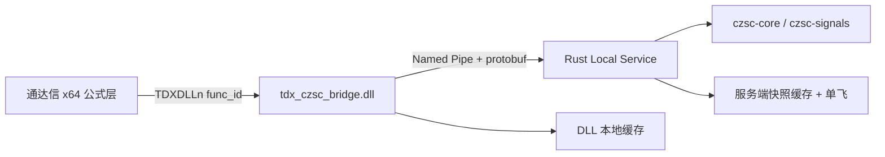

# 通达信缠论自动标注系统 · 技术方案

> **文档定位**：本文件是项目设计与规则细节的**权威记录**，与代码同步更新
> （`README.md` 是项目门面，本文件是内部设计与算法规则）。
> 修改 IPC / DLL / 通道相关代码**之前**，先阅读本文档；改动后同步更新本文档。
>
> 项目状态：原型 / 首轮联调已通过（2026-08-17 Windows x64 真机全链路）。
> 配套文档：[通达信 DLL 函数编程规范](./通达信DLL函数编程规范)（官方规范与示例插件）。

---

## 目录

1. [项目概述](#1-项目概述)
2. [总体架构](#2-总体架构)
3. [方案取舍结论](#3-方案取舍结论)
4. [仓库与模块划分](#4-仓库与模块划分)
5. [通信协议](#5-通信协议)
6. [数据模型](#6-数据模型)
7. [通道设计](#7-通道设计)
8. [算法规则](#8-算法规则)
9. [缓存设计](#9-缓存设计)
10. [配置设计](#10-配置设计)
11. [性能设计](#11-性能设计)
12. [稳定性与安全](#12-稳定性与安全)
13. [日志与诊断](#13-日志与诊断)
14. [已知限制](#14-已知限制)
15. [实施状态与路线图](#15-实施状态与路线图)
16. [风险与应对](#16-风险与应对)
17. [验收标准](#17-验收标准)
18. [下一步建议](#18-下一步建议)

---

## 1. 项目概述

### 1.1 项目目标

把成熟的 Rust `czsc` 生态接入 **通达信 x64**，形成一套**本地运行、可调试、可扩展**
的缠论自动标注方案——分型、笔、中枢、段、买卖点自动计算，并在通达信主图标注。

### 1.2 已知前提（硬约束）

1. 通达信 DLL ABI：3 路输入 `float[]`（HIGH/LOW/CLOSE）+ 1 路输出 `float[]`；
2. 复杂缠论对象（分型/笔/中枢/段）必须**降维为多通道输出**；
3. 算法核心复用 `czsc-core` / `czsc-signals`，不重写缠论算法；
4. 最终图形表达能力受通达信公式系统限制。

### 1.3 设计原则

- **算法在服务端**：Rust 本地服务承担全部缠论计算，通达信公式层只做显示；
- **协议先行**：`proto/analysis.proto` 是通道/消息的唯一事实来源；
- **通道化输出**：按 `func_id` 输出对齐 `DataLen` 的 `float[]` 通道；
- **强缓存**：DLL 本地缓存 + 服务端快照缓存两级，保证通达信高频调用下的体验；
- **可回归**：真实行情 CSV 驱动的回归测试锁定通道值与绘制规则。

---

## 2. 总体架构



### 2.1 分层职责

| 层 | 组成 | 职责 |
|---|---|---|
| **公式层** | `tdx_formula_examples/*.tn6` | 调用 `TDXDLLn(func_id, HIGH, LOW, CLOSE)` 并按通道绘制；不承担算法 |
| **Bridge DLL** | `bridge_dll/`（x64 C++） | 导出 `RegisterTdxFunc`；按 `func_id` 路由输出通道；DLL 本地缓存；Named Pipe 客户端（OVERLAPPED 超时 + 连接重试）；服务自动拉起/退出回收 |
| **Rust Service** | `rust_service/` | 请求 → `RawBar` → `czsc-core`/`czsc-signals` → `AnalysisSnapshot`；服务端缓存与并发合并；健康/版本接口 |

### 2.2 数据流（一次完整分析）

```text
公式 TDXDLLn(func_id, ...)
  → DLL 查本地缓存（命中则直接回填，不发起 IPC）
  → DLL 拼 RequestEnvelope 经 Named Pipe 发送（4 字节 LE 长度 + protobuf）
  → handlers::handle_request 分发
  → analyze::handle：CacheKey → 缓存/singleflight → spawn_blocking 全量分析
  → analyzer::build_snapshot：RawBar → CZSC → 分型/笔 → 中枢/段/买卖点 → 通道 + 对象
  → 回写服务端缓存、唤醒同数据段等待者
  → ResponseEnvelope 回填 pfOUT[]
```

### 2.3 服务生命周期

- DLL 检测到管道不存在时**自动拉起**同目录 `tdx_czsc_service.exe`（日志写
  `tdx_czsc_service.log`）；服务 exe 路径可用 `tdx_czsc_bridge.ini` 或环境变量
  `TDX_CZSC_SERVICE_EXE` 覆盖；
- 通达信退出（含崩溃）时服务由 **Job Object（`KILL_ON_JOB_CLOSE`）自动终止**；
- 无需手动启动/停止服务（联调期可 `cargo run` 手动启动先行验证）。

---

## 3. 方案取舍结论

经历 2026-08 首轮联调验证后确认的关键取舍：

| 问题 | 结论 |
|---|---|
| 一次调用返回全部对象？ | **不追求**。协议与缓存都以"按 func_id 取通道"为粒度 |
| DLL 层要不要缓存？ | **必须强缓存**（约 19 次/轮同数据段调用，只允许 1 次全量分析） |
| 通道输出用价格还是标志位？ | **用价格**（便于公式直接 `DRAWICON`/`STICKLINE`/`DRAWTEXT`） |
| IPC 选型 | **Windows Named Pipe**（本地、无广播、可 OVERLAPPED 超时）；不选 TCP/共享内存 |
| 公式层承担算法？ | 否，公式层保持最薄，只做显示 |

---

## 4. 仓库与模块划分

### 4.1 仓库结构（实际状态）

```text
tdx_czsc/
├── proto/analysis.proto          # 协议唯一事实来源（prost-build 生成 Rust 绑定）
├── rust_service/                 # Rust 分析服务
│   ├── src/
│   │   ├── analyzer/             # 纯分析逻辑（无运行时状态依赖）
│   │   ├── handlers/             # 信封分发 + 分析协调 + 调试通道
│   │   ├── cache/  state/  config/  ipc/   # 运行期支撑
│   │   ├── main.rs               # 入口 + tracing 初始化（--log 支持）
│   │   └── lib.rs                # 模块声明与对外 API
│   ├── examples/analyze_csv.rs   # 离线 CSV 分析工具
│   └── tests/                    # 真实数据回归测试（含 tests/common 共享设施）
├── bridge_dll/                   # x64 C++ DLL + 冒烟测试 + ini 样例
├── tdx_formula_examples/         # 通达信公式模板（main_chart_full.tn6）
├── tests/data/                   # 回归测试真实行情 CSV
├── docs/                         # 本文档 + 通达信 DLL 编程规范
├── deploy_to_tdx.bat             # 一键部署（默认 D:\new_tdx64）
├── CONTRIBUTING.md               # 贡献指南 + Rust 代码结构约定
└── LICENSE                       # MIT
```

### 4.2 Rust 模块职责表

| 模块 | 职责 | 依赖方向 |
|---|---|---|
| `analyzer/mod.rs` | 快照编排（`build_snapshot`）+ `AnalysisParams`（请求+配置 → 纯参数） | 只依赖子模块 |
| `analyzer/rawbars.rs` | 请求 → RawBar（频率解析/量能来源链/时间轴合成） | → error |
| `analyzer/pivots.rs` | 中枢构建（原生 + 前端/后端优化）+ 三买三卖严格化 | → objects（仅下标对齐） |
| `analyzer/segs.rs` | 线段识别（特征序列分型法） | 无 |
| `analyzer/signals.rs` | 401~406 买卖点信号（挂起/提交/去重/依附） | → objects（锚点对齐） |
| `analyzer/channels.rs` | func_id → float[] 通道 + 通道元数据单一映射表 | → objects/segs/signals |
| `analyzer/objects.rs` | K线下标对齐（`fx_mid_index`）+ proto 对象映射（`TryFrom`） | 无 |
| `analyzer/error.rs` | `AnalysisError`（thiserror 类型化错误） | 无 |
| `handlers/mod.rs` | 信封分发 + 错误 → 协议状态码映射 | → analyzer |
| `handlers/analyze.rs` | CacheKey 组装、singleflight、并发上限、spawn_blocking 分析 | → analyzer/cache/state |
| `handlers/debug.rs` | 调试通道（901~903）补丁 + 耗时统计 | 无 |
| `handlers/health.rs` `version.rs` | 健康/版本接口 | → state |
| `cache/mod.rs` | `CacheKey` + LRU `SnapshotCache` | 无 |
| `state.rs` | `AppState`：缓存/单飞表/信号量/计数 | → cache/config |
| `config.rs` | `AppConfig` 默认值 | 无 |
| `ipc/mod.rs` | Named Pipe 服务 + 帧协议 | → handlers |

> 结构约定（新增代码遵守）：错误分层（`AnalysisError` → 状态码）、抽象门槛
> （至少 2~3 个实现才引入 trait，表驱动优先）、对象映射走 `TryFrom`。
> 详见 `CONTRIBUTING.md`。

### 4.3 Bridge DLL 模块

- `include/bridge_config.h`、`bridge_service_protocol.h`：配置与协议常量；
- `src/bridge_functions.cpp`：`RegisterTdxFunc` 导出与 `func_id` 路由、量能融合；
- `src/bridge_ipc_client.cpp`：Named Pipe 客户端（超时/重试/自动拉起）；
- `tests/ipc_client_smoke.cpp`：控制台冒烟测试 `tdx_czsc_ipc_smoke_test.exe`。

---

## 5. 通信协议

### 5.1 消息定义（`proto/analysis.proto`）

```text
RequestEnvelope  { protocol_version, request_id, body(Analyze|Health|Version) }
ResponseEnvelope { protocol_version, request_id, status, error_message, body }

StatusCode:
  STATUS_CODE_UNSPECIFIED=0  STATUS_OK=1  STATUS_INVALID_REQUEST=2
  STATUS_UNSUPPORTED_VERSION=3  STATUS_TIMEOUT=4  STATUS_SERVICE_BUSY=5
  STATUS_ANALYZE_FAILED=6  STATUS_INTERNAL_ERROR=7

AnalyzeRequest   { func_group, requested_func_ids[], symbol_hint, freq_hint,
                   data_len, input_hash, bar_build_mode, series, options,
                   prefer_cached, caller_instance_id }
AnalyzeResponse  { snapshot, service_cache_hit, timing }
MarketSeries     { open[], high[], low[], close[], vol[], amount[], dt_unix_ms[] }
CzscOptions      { max_bi_num, min_bi_len, analysis_window,
                   include_channels, include_objects, enable_incremental }
AnalysisSnapshot { meta, channels[], fractals[], strokes[], pivots[],
                   signals[], segments[] }
```

其余消息：`SnapshotMeta`、`ChannelSeries{func_id, kind, name, values}`、
`FractalPoint`、`StrokeSegment`、`PivotZone`、`Segment`、`SignalPoint`、
`TimingStats`、`HealthRequest/Response`、`VersionRequest/Response`。

### 5.2 帧格式（Named Pipe）

```text
[u32 小端长度][protobuf 载荷]
```

读写均为"先读 4 字节长度、再读定长载荷"；DLL 侧带读写超时
（`TDX_CZSC_REQUEST_TIMEOUT_MS`，默认 3000ms）。

### 5.3 错误分层与状态码映射

- 分析管线返回类型化错误 `AnalysisError`（`analyzer/error.rs`）：
  `InvalidRequest(请求校验/缺失序列/长度不齐/空窗口/不支持 func_id)`、
  `UnsupportedFreq(周期提示无法解析)`、`InvalidBarData(单根K线构造失败)`；
- `handlers/mod.rs` 统一映射状态码：

| 错误 | 状态码 |
|---|---|
| `InvalidRequest` / `UnsupportedFreq` | `STATUS_INVALID_REQUEST` |
| `InvalidBarData` | `STATUS_ANALYZE_FAILED` |
| 非分析错误（任务/运行时异常） | `STATUS_INTERNAL_ERROR` |

- `AnalysisError` 为 `Send + Sync + 'static`，经 `anyhow::Error::downcast_ref`
  从任意上下文中取回用于映射。

---

## 6. 数据模型

### 6.1 DLL 输入约定

公式传参固定为 `TDXDLLn(func_id, HIGH, LOW, CLOSE)`：
第 1 路 HIGH、第 2 路 LOW、第 3 路 CLOSE。
量能（VOL）经 **950 通道**单独上传（见 [7.3](#73-量能输入与一买一卖背驰)）。

### 6.2 RawBar 构造策略（`analyzer/rawbars.rs`）

- 从 `MarketSeries` 按窗口切片构造：`analysis_window=0`（默认）表示
  **全量**（从首根开始），正数取尾部 N 根（`window_start_of`，见
  `analyzer/mod.rs`）；`id` = 原始 bar 下标（与通道对齐的关键）；
- 时间轴：优先 `dt_unix_ms`，缺失时按频率合成（基准 2000-01-01）；
- 量能三级来源链（见 7.3）；
- 频率解析：空串回退 30 分钟，支持 `D`/`1d`/`30m`/`F30` 等别名。

### 6.3 分析参数（`AnalysisParams`）

`build_snapshot(request, params)` 是**纯函数**：`AnalysisParams` 由请求选项 +
服务配置解析而来（选项优先、配置兜底）：

```text
analysis_window / max_bi_num / min_bi_len / derive_volume_proxy / czsc_version
```

实现为 `From<&AppConfig>` 与 `From<(&AnalyzeRequest, &AppConfig)>`；分析管线
不接触运行时状态，可独立测试与复用。

### 6.4 输出快照

```text
AnalysisSnapshot
├── meta      （symbol/freq/data_len/input_hash/窗口/笔参数/版本/生成时间）
├── channels  （对齐 DataLen 的 func_id → float[]，DLL 直接按 func_id 回填）
└── objects   （include_objects=true 时附带：分型/笔/中枢/买卖点/段对象，
               全部对齐到原始K线下标，供 CSV 工具链/调试使用）
```

对象映射（`analyzer/objects.rs`）统一走标准转换 trait `TryFrom`：
`FractalPoint ← &FX`、`StrokeSegment ← &BI`、`PivotZone ← &ZS`；
映射失败（对象缺可对齐下标）返回 `AlignError`，调用方按跳过处理。

---

## 7. 通道设计

### 7.1 设计目标

- 通道值**全部对齐 `DataLen`**（长度与输入一致，DLL 零转换直接回填）；
- 输出**价格/方向数值**而非标志位（公式层可直接画点/线/文字）；
- `func_id` ↔ 通道一一映射，单一来源：`analyzer/channels.rs`。

### 7.2 通道函数号（实际实现）

| func_id | 通道名 | 说明 |
|---:|---|---|
| 101 | `fx_top` | 顶分型（分型**极值K线**处输出价格） |
| 102 | `fx_bottom` | 底分型 |
| 201 | `bi_points` | 笔端点（每笔起止分型价格） |
| 202 | `bi_direction` | 笔方向（覆盖区间 ±1，上=1 下=-1） |
| 203 | `seg_points` | 段端点（**仅已确认段**） |
| 204 | `seg_direction` | 段方向（仅已确认段，覆盖区间 ±1） |
| 301 | `zs_upper` | 中枢上沿 `zg` |
| 302 | `zs_lower` | 中枢下沿 `zd` |
| 303 | `zs_middle` | 中枢中轴 `zz` |
| 304 | `zs_boundary` | 中枢左右界标记：1=左界、2=右界、3=左右界共用 |
| 401~406 | `buy1`…`sell3` | 一买/一卖/二买/二卖/三买/三卖 |
| 901 | `debug_cache_hit` | 调试：缓存命中（1/0） |
| 902 | `debug_service_ready` | 调试：服务就绪（恒 1） |
| 903 | `debug_latency_ms` | 调试：最近一次请求耗时（ms） |
| 950 | `vol_input` | **量能输入通道**（只上传 VOL，不发起分析） |

> `handlers/version.rs` 的 `supported_func_ids` 引用同一常量表，二者不会漂移。

### 7.3 量能输入与一买/一卖背驰

通达信 DLL ABI 只有 3 路输入，无法同时传 CLOSE 与 VOL，公式需**额外调用一次**
量能通道（注意放在 401~406 之前求值；顺序颠倒时 DLL 进程级缓存会在下一轮
刷新后命中，同样生效）：

```text
TDXDLL1(950, HIGH, LOW, VOL)
```

- DLL 以「数据段指纹」（`data_len` + 前两路 HIGH/LOW 哈希，与第三路无关）缓存
  VOL 序列，并在后续 101/401 等分析请求构造时融合进 `MarketSeries.vol`；
- 融合后 `input_hash` 纳入量能，DLL 与服务端缓存自动区分「带量/不带量」结果。

**量能来源链（服务端）**：

1. 请求携带真实 `vol`（950 通道 / CSV 工具链）——原样使用；
2. vol 缺失且 `derive_volume_proxy=true`（默认）——以单根相对振幅
   `(high-low)/close×100` 派生代理量，恢复「价格背驰 AND（量能 OR 长度）」
   完整判定；
3. 其余（旧公式且关闭代理）——vol=0，量能背驰恒不成立。

### 7.4 通道映射约定（价格而非标志位）

- 分型/笔端点：在对象所在 bar 输出**价格**，其余 bar 为 0；
- 方向通道（202/204）：覆盖区间填 ±1，其余 0；
- 中枢通道（301~303）：绘制区间填 `zg`/`zd`/`zz`，其余 0；
- 304：首 K 线填 1、尾 K 线填 2；既是前中枢右界又是后中枢左界的共享 K 线
  填 3（先统一写左界再写右界，避免覆盖丢失）；
- 买卖点：在信号锚点 bar 输出**分型价格**。

---

## 8. 算法规则

### 8.1 分型与笔（czsc-core）

- 包含关系处理（`remove_include`）与分型/笔识别由 `czsc-core` 完成；
- 已完成笔 = `get_finished_bis()`（已处理"最后一笔待确认"的实时场景）；
- **K线下标对齐**（`fx_mid_index`，见 `analyzer/objects.rs`）：czsc 合并后的
  NewBar `id` 锚定合并组**第一根**原始K线、`dt` 锚定**极值**K线；分型定位须
  在中间元素的原始K线中查找 `dt == fx.dt` 的那一根取 id，否则分型会画到
  合并组起点造成漂移（回归测试锁定 002340 案例）。

### 8.2 中枢（`analyzer/pivots.rs`）

在原生 `czsc-core::get_zs_seq`（贪心笔归属）之上做**前端/后端优化**：

**前端（第一笔）**：中枢第一笔必须与行情趋势相反——上升行情第一笔向下
（"下上下"重叠）、下跌行情第一笔向上（"上下上"重叠）。行情方向按**中枢
高低位置**判定：

- 后一个中枢中轴（`zz`）比前一个高 → 上升行情；更低 → 下降行情；中轴平齐
  沿用前一趋势；
- 第一个中枢无前序中枢：以其位置与**窗口起点价格**比较兜底；
- 首笔与趋势同向视为**进入/连接笔**，予以剔除；区间 `[zd, zg]` 由剔除后的
  前 3 笔重叠重新计算；剔除后不足 3 笔或前 3 笔无重叠的中枢整组剔除。

**后端（最后一笔）**：中枢最后一笔与行情趋势相反（与前端对称，中枢为
**奇数笔结构**）——末笔与趋势同向视为**离开笔**，予以剔除。

**相邻间隔**：前一个中枢后端与后一中枢前端**不得共享端点**，必须至少
间隔一笔——离开/连接笔落在两个中枢矩形之间，不属于任一中枢。

**优先级：前端优化优先于后端**。两端共享端点时：

1. 后中枢前端（首笔方向规则）不可改动；
2. 前中枢末端退回一笔（间隔规则）；
3. 退回后若末笔与趋势同向，还需再退一笔（方向规则）；
4. 循环直至两条规则都满足，或缩至最少 3 笔；缩到 3 笔仍无法同时满足的
   候选中枢整组剔除（不绘制）。

**绘制**：绘制区间 = 优化后中枢**首笔起点 → 末笔终点**（整段绘制，见
`objects::zs_span`）。

### 8.3 段（线段，`analyzer/segs.rs`）

特征序列分型法（缠论 65 课标准线段终结判定，移植自 Vespa314-chan）：

- 段 = 至少 3 笔、首笔与末笔同方向；终结由**特征序列分型**确认；
- 特征序列元素 = 反向笔，按线段方向做包含合并（向上取高高低、向下取低低高高）；
- 第三元素必须"实际突破"才构成分型；特征序列出现**缺口**时需后续反向分型确认；
- 确认段（`is_sure=true`）覆盖全部已完成笔（相邻段不重叠、不遗漏）；
- 尾部剩余笔收集为**未完成段**（`is_sure=false`）：对象输出保留供调试，
  203/204 显示通道只输出已确认段；
- 校验：向上段起点低于终点、向下段起点高于终点。

### 8.4 买卖点（`analyzer/signals.rs`）

接入 `czsc-signals` 官方信号函数（一买/一卖标准信号，二/三类均线辅助判定），
逐根 K 线演化 CZSC 并评估：

- **单遍演化（P0）**：演化完成的 CZSC 终态与 `CZSC::new(bars)` 等价
  （czsc-core 的 `new` 内部即逐根 `update_bar`），直接复用为结构通道
  输入——同一窗口只跑一遍演化，不再做第二遍全量扫描（未请求信号
  通道时走 `CZSC::new` 快速路径）；
- **不做"最终态一次性评估"**：czsc-signals 的 4 个信号函数只检查
  `bi_list` **尾部窗口**（最近 5/21/19/... 笔），最终态评估只能发现
  最新笔结构当前的信号，历史买卖点（演化过程中曾命中的）会全部丢失；
  逐根演化是保留全部历史买卖点的必要方式（回归测试锁定）；
- **锚点**：信号锚在笔端分型的**极值K线**（与分型/笔/中枢通道对齐）；
- **挂起/提交**：信号出现先挂起，待锚定笔被后续新笔确认（不再是未笔、未被
  重构）后才提交——避免锚在演化中被破坏/合并的临时笔端点上；
- **去重**：状态型信号同一信号段只记录一次；同一锚点上多信号只保留优先级
  最高的（func_id 最小：一买 > 一卖 > 二买 > 二卖 > 三买 > 三卖）；
- **缠论关联**：二买/二卖必须依附最近一买/一卖、且为该一买/一卖后的**首个**
  回调/反弹确认点（每结构内最多一个）；
- **三买/三卖严格化**：依附中枢，每个中枢最多一个三买和一个三卖（按"锚点
  之前最近结束的中枢"归属）；
- **孤儿点过滤**：只保留锚定在最终可见笔端点上的点（不锚在已被 `max_bi_num`
  清理的早期笔上）；
- **性能**：只在笔结构变化（数量或末笔端点变化）的 K 线上重新评估，避免对
  每根 K 线跑全部信号函数。

### 8.5 量能背驰（一买/一卖）

一买/一卖为「价格背驰 AND（量能 OR 长度）背驰」组合判定（`czsc-signals`），
量能数据来源见 [7.3](#73-量能输入与一买一卖背驰)。

---

## 9. 缓存设计

### 9.1 缓存键（`CacheKey`）

请求中影响分析结果的参数子集：

```text
func_group + input_hash + data_len + freq_hint
+ max_bi_num + min_bi_len + analysis_window
```

（`#[derive(PartialEq, Eq, Hash)]`；`input_hash` 由 DLL 侧按数据段指纹计算，
纳入量能与否自动区分带量/不带量结果。）

### 9.2 两级缓存

| 层 | 容量 | 说明 |
|---|---|---|
| DLL 本地快照缓存 | 默认 16 条（`TDX_CZSC_CACHE_CAPACITY`） | 通达信每轮刷新约 19 次调用，仅首个未命中触发 IPC |
| 服务端快照缓存 | 64 条（`AppConfig::cache_capacity`） | 多公式/多窗口共享 |

### 9.3 并发策略（服务端）

- **singleflight**：同 `CacheKey` 的在途分析合并为一次（`in_flight` 表 +
  `Notify`，等待方 15s 超时兜底后自行接管，失败必唤醒）；
- **并发上限**：全量分析并发上限 2（`analysis_slots` 信号量），防多窗口同时
  首刷打满 CPU 全部超时；
- 全量分析在 `spawn_blocking` 线程池执行，不占用 runtime worker；
- `prefer_cached=true` 的请求（如纯调试通道）直接查缓存。

### 9.4 增量状态缓存（enable_incremental）

> 服务端默认开启（`AppConfig::enable_incremental=true`，纯服务端策略，
> 不涉及协议与 DLL 改动；请求 `CzscOptions.enable_incremental` 字段预留
> 可额外强开，关闭需改配置）。

- 增量状态 = 窗口 K 线副本 + 已演化的 `CZSC` + 信号评估器
  （`analyzer/incremental.rs`），按（周期 + 笔参数 + 窗口）LRU 缓存
  （`incremental_cache_capacity`，默认 8）；窗口 K 线副本用于前缀校验——
  czsc-core 会按 Python 语义修剪 `czsc.bars_raw`（掐头到第一笔起点），
  不能作为比对基准；
- 新请求与缓存序列**前缀一致**时（全量窗口的序列增长、等长末笔原地更新
  ——盘中刷新），只对新增 K 线 `update_bar + observe`（O(新增)）后装配
  快照，并把演化后的状态放回缓存；
- 不适用场景自动回退全量分析，同时建立增量状态供后续承接：
  无状态（首建）、前缀不一致（历史数据修正/尾窗口平移）、窗口缩短、
  `max_bi_num` 等参数变化、需要信号但缓存评估器缺失（此前只算结构）；
- 输出与全量路径**位级一致**（共用 `signals::evolve_bars` 演化核心，
  回归测试 `incremental_regression.rs` 逐通道逐值锁定）；
- 并发：取出→（锁外演化）→放回；同条目并发取出时后取者走全量，
  放入总是完整状态，正确性不受影响。

---

## 10. 配置设计

### 10.1 服务端（rust_service）

`AppConfig` 默认值（`rust_service/src/config.rs`）：

```text
protocol_version=1.0.0  service_version=CARGO_PKG_VERSION
pipe_name=\\.\pipe\tdx_czsc_analyzer
request_timeout_ms=50（DLL 侧超时由 DLL 配置决定）
max_bi_num=1000  min_bi_len=6  default_analysis_window=0（0 = 全量）
cache_capacity=64  incremental_cache_capacity=8  analysis_parallelism=4
derive_volume_proxy=true  enable_incremental=true
```

> `max_bi_num=1000` 对齐 czsc Python 默认：全量历史下笔数可达数百根
> （20 年日线约 400~600 笔），避免早期笔被清理导致历史结构/买卖点缺失。
> `default_analysis_window=0` 即**全量**（分析传入的全部 K 线），配合
> 增量缓存使序列增长/盘中原地更新走增量承接；如需限窗可配正数
> （取尾部 N 根，注意固定尾窗口的序列增长回退全量）。
> `analysis_parallelism=4`（P1）：全量分析并发上限，多窗口/多周期/
> 多标的场景可调大；增量承接与缓存命中不占槽位。

### 10.2 DLL 侧（参数优先级：环境变量 > ini > 内置默认）

| 参数 | 默认 | 说明 |
|---|---|---|
| `TDX_CZSC_REQUEST_TIMEOUT_MS` | 3000 | 单次请求读写超时（首刷 100~240ms，多窗口并发排队留 3s 余量） |
| `TDX_CZSC_CACHE_CAPACITY` | 16 | DLL 本地快照缓存条数（多周期组合图偏多时调大） |
| `TDX_CZSC_MAX_BI_NUM` / `MIN_BI_LEN` / `ANALYSIS_WINDOW` | 1000/6/**0** | 分析参数；`ANALYSIS_WINDOW=0` 即全量（默认），正数取尾部 N 根（尾窗口增长回退全量分析） |
| `TDX_CZSC_SERVICE_EXE` | — | 服务可执行文件路径（拉起用） |

ini 样例：`bridge_dll/tdx_czsc_bridge.ini.example`。

---

## 11. 性能设计

### 11.1 实测（Release，`analyze_csv` 单请求全量分析，`max_bi_num=1000`）

| 场景 | 耗时 |
|---|---|
| 420 根 30 分钟（全量） | 约 13ms |
| 3933 根日线（全量，min_bi_len=6 默认 → 332 笔） | 单遍演化 75ms / 快照总 **170ms** |
| 3933 根日线（全量，min_bi_len=3 → 笔数 >1000 顶格） | 快照总约 258ms |
| 增量承接（全量窗口 + 新增数百根） | 约 5~10ms |
| 同序列缓存命中（滚动/缩放/重复刷新） | 约 10µs |

> 全量覆盖后笔数/信号不再被旧 50 上限截断（002340 全量 332 笔、信号
> 自 index=59 起完整保留）；`max_bi_num=1000` 为 czsc 硬上限，超短线
> 周期下早期笔仍会被清理，可按需调大。

**P1 信号评估热路径**（3933 根全量剖面拆分，`analyze_csv --profile`）：

| 阶段 | P0c 基线 | P1 后 | 说明 |
|---|---|---|---|
| 信号评估 observe | 227.5ms | **51.3ms** | `cxt_second/third_bs` 重实现：O(N) 映射 → O(log N) 二分 + 增量 MA（`signals_fast.rs`） |
| czsc update_bar | 22.9ms | 23.0ms | czsc-core 内核（未改） |
| pivots+segs | 5.0ms | 5.0ms | — |
| channels / objects / 编码 | 0.27 / 0.08 / 0.19ms | 同左 | 数量级证明"通道并行"无意义（P1 剖面先行结论） |
| **快照总耗时** | **523ms** | **170ms** | 3.1× 提速 |

> 信号输出与优化前**逐条一致**：对照测试 `signals_fast_parity`（新旧
> 实现多状态连续喂入逐字符比对）+ 既有信号回归全绿。

### 11.2 吞吐设计

- 通达信每轮刷新对同一数据段约 19 次 `TDXDLLn` 调用 → DLL 缓存吸收 18 次，
  只有 1 次 IPC 分析；
- 服务端缓存 + singleflight + 并发上限（`analysis_parallelism`，默认 4，
  多窗口/多标的场景可调大）→ 多窗口首刷并行执行而非排队打满 CPU；
- 分析窗口默认**全量**（`analysis_window=0`）：通达信传入的全部 K 线
  参与分析，前方历史全部有标注，窗口首部稳定使增量承接（序列增长/
  盘中原地更新）持续生效，稳态不重放窗口；
- **稳态刷新（增量，P0b）**：只演化新增 K 线并重装请求
  通道（实测 002340：新增 200~300 根约 7~12ms、同序列缓存命中约 10µs；
  纯增量演化部分为单根 `update_bar + observe` 量级）；配置显式尾窗口
  （`data_len > analysis_window`）时序列增长因窗口平移回退全量分析。

---

## 12. 稳定性与安全

### 12.1 DLL 侧原则

- **禁止异常穿透 DLL 边界**：所有失败路径安全降级为 float 输出（0/上次值）；
- 客户端断开（读超时/通达信关闭）为常态，用 warn 级日志避免刷屏；
- 管道创建失败短退避重试，不终止监听；
- 通达信退出由 Job Object 回收服务进程。

### 12.2 Rust 服务侧原则

- 请求校验前置：序列长度/必需字段不合法 → `STATUS_INVALID_REQUEST`，不进入
  分析管线；
- 分析错误按类型映射状态码（见 5.3），DLL 侧按错误降级；
- 单请求异常不影响服务（每请求独立 spawn_blocking + 错误隔离）；
- 全局并发上限（信号量）+ 单飞合并，防 CPU 打满。

---

## 13. 日志与诊断

- **DLL 日志**：`bridge_dll/logs/tdx_czsc_bridge.log`（truncate 策略），记录
  请求/缓存命中/超时/拉起事件；
- **服务日志**：stdout 或 `--log <路径>`（DLL 拉起时写
  `tdx_czsc_service.log`），tracing + env filter（默认 `info`）；
- **诊断通道**：901 缓存命中、902 服务就绪、903 最近耗时；
- **健康接口**（`handle_request` Health 消息）：状态/运行时长/在途请求/缓存
  条数/版本。

---

## 14. 已知限制

1. 通达信 DLL ABI 3 路输入 + 1 路输出，复杂对象只能多通道降维表达；
2. 安装与分发尚未产品化：DLL 依赖 `libprotobuf.dll` / `abseil_dll.dll` 两个
   运行时（目标：静态链接或自带运行时）；
3. 图形表达能力受通达信公式系统限制；
4. 增量分析已启用（窗口首部稳定时稳态 O(新增 K 线)，见 §9.4）；
   固定尾窗口的序列增长因窗口平移回退全量分析；多周期/增量跨周期在
   路线图中。

---

## 15. 实施状态与路线图

| Phase | 内容 | 状态 |
|---|---|---|
| Phase 1：最小闭环 MVP | 协议/服务/DLL/公式/首轮联调 | ✅ 2026-08-17 Windows x64 真机全链路联调通过 |
| Phase 2：中枢与买卖点 | 中枢上下沿通道、401~406 信号、缓存优化、中枢前端/后端优化 | ✅ 已完成（含 304 边界、量能背驰） |
| Phase 3：产品化增强 | 安装/分发（免运行时）、日志滚动、版本检查、诊断面板 | 🚧 部分完成（ini/env 参数、自动拉起已完成；分发方案待办） |
| Phase 4：高级能力 | 多周期分析、图形表达增强、外部可视化 | 🚧 增量更新已完成（P0b，稳态 O(新增)），其余待办 |

---

## 16. 风险与应对

| 风险 | 应对 |
|---|---|
| 通达信绘图表达不够丰富 | 通道化 + 多模板组合；公式层薄，可扩展复合标注 |
| 周期/上下文信息不足（DLL 无周期上下文） | 周期由公式模板在 `freq_hint` 中显式携带；多周期分析列 Phase 4 |
| DLL 高频调用导致卡顿 | 两级缓存 + 单飞 + 并发上限 + 超时兜底；实测首刷 <100ms |
| 算法结果与通达信视觉预期不一致 | 回归测试锁定通道值与绘制规则；公式模板按通道绘制 |

---

## 17. 验收标准

### 17.1 技术验收

- [x] `cargo check --all-targets` 零警告；`clippy -D warnings`、`fmt --check` 通过
- [x] `cargo test` 全绿（单元 + 真实数据回归：通路/段/中枢/信号/背驰）
- [x] 协议生成链（prost-build）正常，`proto/analysis.proto` 与实现同步
- [ ] 分发方案（免运行时依赖）落地

### 17.2 功能验收

- [x] 分型/笔/中枢/段/买卖点在通达信主图显示正确
- [x] 中枢前端/后端/间隔规则在真实数据上可回归（如 002340 日线 7 个互不重叠中枢）
- [x] 量能背驰（950 通道 + 代理量兜底）生效
- [x] 服务断开/通达信退出时安全降级与服务回收

### 17.3 性能验收

- [x] 1000 根日线单次全量分析 < 100ms
- [x] 通达信每轮刷新仅 1 次 IPC 全量分析，其余命中缓存

---

## 18. 下一步建议

1. **分发方案**（Phase 3 首要）：静态链接 protobuf/abseil 或随包分发运行时，
   输出免配置开箱即用的安装包；
2. **多周期分析**：跨周期中枢/背驰（周期上下文经 `freq_hint` 与 950 式附加
   通道扩展协议）；
3. **增量更新**：`enable_incremental` 语义落库，避免整窗口重算；
4. **图形表达增强**：复合公式模板（中枢矩形、买卖点图标、背驰连线）；
5. **性能剖面工具化**：`analyze_csv` 增加耗时/内存画像输出，纳入 CI 回归。