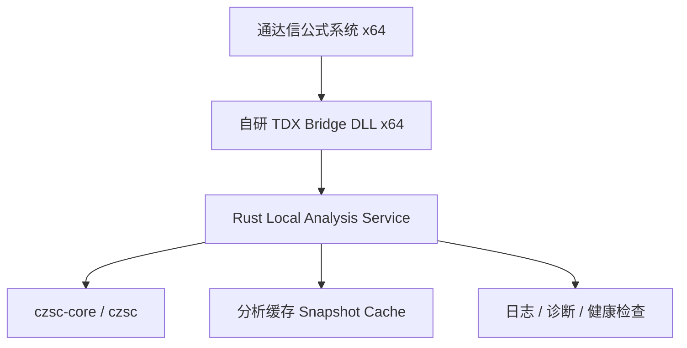

# 通达信缠论自动标注系统技术方案

## 1. 项目概述

### 1.1 项目目标

建设一套运行于 **64 位通达信客户端（x64）** 的本地缠论自动标注系统，核心能力包括：

- 基于 `waditu/czsc` Rust 开源库完成缠论结构识别
- 通过 **自研 x64 通达信 DLL** 接入通达信公式系统
- 通过 **Rust 本地服务** 承载缠论算法、缓存、结果分发和诊断能力
- 在通达信主图/副图中实现分型、笔、中枢、买卖点等自动标注
- 保证本地运行、低延迟、可维护、可升级

### 1.2 已知前提

1. 宿主通达信版本为 **x64**
2. 通达信 DLL 公式接口遵循官方规范：

```cpp
typedef void(*pPluginFUNC)(int DataLen, float* pfOUT, float* pfINa, float* pfINb, float* pfINc);
```

3. 通达信 DLL 扩展天然约束为：
   - 输入：3 路 `float[]`
   - 输出：1 路 `float[]`
4. Rust 算法核心采用开源 `czsc-core` / `czsc` crate，不重复造轮子
5. 系统运行在用户本机，不依赖公网服务

### 1.3 设计原则

- **算法与终端解耦**：通达信只负责展示，Rust 负责分析
- **桥接层尽量薄**：DLL 只做接入、缓存调度、IPC 通信和异常隔离
- **先结构化、后绘图化**：服务返回结构化结果，DLL/公式层按通道映射显示
- **单次分析、多通道复用**：避免通达信多次调用导致重复计算
- **本地优先、可诊断优先**：保证问题可定位、可复现、可升级
- **面向 x64 宿主稳定实现**：避免依赖未知的第三方闭源 DLL

---

## 2. 总体架构

### 2.1 推荐架构

采用 **架构 1：x64 C++ Bridge DLL + Rust 本地服务 + CZSC Rust Core**。



### 2.2 架构分层职责

#### A. 通达信公式层
负责：

- 调用 `TDXDLLn(func_id, v1, v2, v3)`
- 将 `HIGH` / `LOW` / `CLOSE` 等序列传给 DLL
- 使用返回的单通道 `float[]` 进行公式绘图
- 组合多个公式通道形成最终标注效果

#### B. 自研 Bridge DLL（x64）
负责：

- 按通达信官方 ABI 导出 `RegisterTdxFunc`
- 接收 3 路 `float[]` 输入和 `DataLen`
- 为不同 `func_id` 提供不同输出通道
- 针对同一批图表数据做本地缓存命中
- 必要时向 Rust 服务发起 IPC 请求
- 将 Rust 结构化结果映射回 `float[]`
- 吞掉内部异常，确保不拖垮通达信

#### C. Rust Analysis Service
负责：

- 提供本地 IPC 服务接口
- 构造 `RawBar` 并调用 `czsc-core`
- 统一输出结构化分析结果
- 管理缓存、版本、健康检查、日志
- 后续支持多周期、增量更新、回放等能力

#### D. CZSC 算法核心
直接复用开源库：

- `czsc-core`
- 需要时再扩展 `czsc-signals` / `czsc-trader`

---

## 3. 核心技术结论

### 3.1 自研 DLL 能解决的问题

自研桥接 DLL 可以显著解决以下问题：

- 适配 **x64 通达信主进程**
- 不再依赖闭源 `tdx_http.dll`
- 自定义 IPC 协议与超时策略
- 增加分析缓存，降低重复计算
- 增加日志、诊断、版本握手
- 自定义多通道结果分发策略

### 3.2 自研 DLL 不能消除的根本限制

仍需接受通达信公式 DLL ABI 的基础约束：

1. **输入仍然只有 3 路 `float[]`**
2. **输出仍然只有 1 路 `float[]`**
3. **公式层对外表达仍是单通道序列**
4. **时间、符号、周期等复杂上下文不能自然通过 ABI 完整传递**
5. **复杂图形能力仍受限于通达信公式绘图系统**

### 3.3 方案可行性判断

结论：

- **工程可行：高**
- **MVP 落地可行：高**
- **复杂缠论全量工作站体验：中等**
- **长期可维护性：高（在自研 DLL 前提下）**

---

## 4. 关键设计思路

## 4.1 不追求“一次调用返回全部对象”

由于通达信一次只能拿到一条 `float[]`，系统必须采用：

> **单次分析，按通道分发结果**

即：

- 通达信公式层会多次调用 DLL，不同 `func_id` 请求不同结果通道
- DLL 针对同一批输入数据只触发一次分析
- Rust 服务返回完整结构化结果
- DLL 将缓存结果拆分成不同输出数组返回给通达信

## 4.2 通道化设计优于“结果编码大杂烩”

不建议把所有信号编码到一个通道中（例如 1/2/3/-1/-2 混合），因为：

- 通达信公式层难维护
- 绘图语义复杂
- 后续扩展困难

建议按功能拆通道，例如：

- 顶分型序列
- 底分型序列
- 笔端点序列
- 中枢上沿
- 中枢下沿
- 一买点
- 一卖点

## 4.3 DLL 层必须强缓存

通达信会在同一公式或多个公式中反复调用 DLL。

如果每次调用都重新跑 `czsc`：

- 延迟高
- CPU 浪费严重
- 用户切图/刷新时体验会明显变差

因此 DLL 必须具备：

- 数据摘要计算
- 最近结果缓存
- 按图表上下文命中快照
- 通道复用

---

## 5. 模块划分

## 5.1 仓库建议结构

```text
tdx_czsc/
├── docs/
│   ├── 技术方案_通达信缠论自动标注系统.md
│   ├── 通达信DLL函数编程规范/
│   └── ...
├── bridge_dll/
│   ├── include/
│   ├── src/
│   ├── tests/
│   └── CMakeLists.txt
├── rust_service/
│   ├── Cargo.toml
│   ├── src/
│   │   ├── main.rs
│   │   ├── ipc/
│   │   ├── api/
│   │   ├── analyzer/
│   │   ├── mapper/
│   │   ├── cache/
│   │   ├── config/
│   │   └── model/
│   └── tests/
├── proto/
│   ├── analysis.proto
│   └── build.rs (如采用 protobuf)
├── tdx_formula_examples/
│   ├── fx_top.tn6
│   ├── fx_bottom.tn6
│   ├── bi_points.tn6
│   └── zs_band.tn6
└── scripts/
```

## 5.2 Bridge DLL 模块划分

建议 C++ DLL 拆成：

- `exports/`：导出函数与 `RegisterTdxFunc`
- `plugin/`：通达信函数路由与 `func_id` 分发
- `context/`：输入数组摘要、图表上下文推断
- `cache/`：最近结果缓存
- `ipc/`：与 Rust 服务通信
- `mapping/`：结构化结果映射为 `float[]`
- `logging/`：本地日志
- `safety/`：SEH / 异常保护 / 超时策略

## 5.3 Rust Service 模块划分

建议 Rust 服务拆成：

- `ipc`：本地 IPC 服务端
- `model`：请求、响应、结果结构
- `analyzer`：`RawBar` 构造与 `czsc` 调用
- `mapper`：FX/BI/ZS/BuySell 等结果整理
- `cache`：服务级缓存
- `config`：配置和默认参数
- `diagnostics`：健康检查与日志

---

## 6. 通信方案设计

## 6.1 IPC 方案比较

### 方案候选

1. 本地 HTTP
2. Windows Named Pipe
3. 共享内存
4. C++ 直接调用 Rust 动态库

### 推荐：Windows Named Pipe

推荐桥接 DLL 与 Rust 服务之间使用 **Named Pipe**。

#### 原因

- 本地 IPC，延迟低于 HTTP
- 不占 TCP 端口
- 不易与安全软件产生误报的网络行为
- 协议更可控
- 适合请求/响应模式
- 调试和日志仍相对容易

### 不优先推荐的方案

#### HTTP
优点：调试简单。缺点：端口、超时、网络语义不必要。

#### 共享内存
优点：高性能。缺点：复杂度高、同步成本高，不适合第一阶段。

#### 直接调用 Rust 动态库
优点：极致低延迟。缺点：宿主崩溃风险大、ABI 边界复杂，不建议第一版采用。

## 6.2 命名管道建议

建议使用固定管道名：

```text
\\.\pipe\tdx_czsc_analyzer
```

服务启动后监听该管道，DLL 通过请求/响应完成分析调用。

---

## 7. 数据模型设计

## 7.1 DLL 输入层模型

来自通达信的原始输入为：

```cpp
(int DataLen, float* pfOUT, float* pfINa, float* pfINb, float* pfINc)
```

建议第一版约定输入语义如下：

- `pfINa` -> `HIGH`
- `pfINb` -> `LOW`
- `pfINc` -> `CLOSE`

原因：

- 分型、笔、中枢核心几何结构主要依赖高低点
- `CLOSE` 可用于补充收盘与绘图对齐
- 比 `OPEN/HIGH/LOW` 更适合结构识别

## 7.2 Rust 请求模型

建议桥接 DLL 发给服务的请求结构包含：

```text
AnalyzeRequest
- protocol_version
- request_id
- func_group
- data_len
- freq_hint
- bars:
  - index
  - high
  - low
  - close
- hash
- options
```

说明：

- `func_group`：指同一组分析结果，例如 `single_level_czsc`
- `freq_hint`：由 DLL 配置或公式约定提供
- `hash`：输入数据摘要，用于缓存命中
- `options`：后续可扩展最小笔长度、最大笔数等参数

## 7.3 Rust 内部 `RawBar` 构造策略

由于通达信 ABI 没有直接提供完整 `RawBar` 字段，第一版构造规则建议为：

- `symbol = "TDX"` 或从配置映射中获取
- `freq = 根据公式通道或 DLL 配置决定`
- `id = index`
- `dt = 伪时间序列` 或按索引生成稳定递增时间
- `open = close`
- `close = close`
- `high = high`
- `low = low`
- `vol = 0.0`
- `amount = 0.0`

### 说明

第一版不依赖真实时间也可以完成大多数结构识别，因为 `czsc-core` 的主要结构计算依赖顺序和价格关系。

但后续若要支持：

- 更复杂信号
- 真实时间显示
- 多周期联动

则需要增强上下文建模能力。

## 7.4 Rust 输出结构

Rust 服务不应直接返回“绘图命令”，而应返回结构化分析快照：

```text
AnalysisSnapshot
- meta
  - hash
  - data_len
  - freq
  - min_bi_len
  - max_bi_num
- channels
  - fx_top
  - fx_bottom
  - bi_points
  - zs_upper
  - zs_lower
  - buy1
  - sell1
- objects
  - fx_list
  - bi_list
  - zs_list
```

其中 `channels` 是已经对齐 `DataLen` 的 `Vec<f32>`，方便 DLL 直接映射回 `pfOUT`。

---

## 8. 通道与函数号设计

## 8.1 设计目标

采用 `func_id` 代表输出通道，通达信公式可多次调用 DLL 取得不同结果。

## 8.2 推荐函数号规划

### A. 基础结构通道

| func_id | 通道名 | 含义 | 输出内容 |
|---:|---|---|---|
| 101 | `fx_top` | 顶分型 | 分型位置输出高点，否则 0 |
| 102 | `fx_bottom` | 底分型 | 分型位置输出低点，否则 0 |
| 201 | `bi_points` | 笔端点 | 笔确认端点输出价格，否则 0 |
| 202 | `bi_direction` | 笔方向 | 向上=1，向下=-1，否则 0 |
| 301 | `zs_upper` | 中枢上沿 | 有效中枢上沿，否则 0 |
| 302 | `zs_lower` | 中枢下沿 | 有效中枢下沿，否则 0 |
| 303 | `zs_mid` | 中枢中轴 | 中轴价格，否则 0 |

### B. 买卖点通道

| func_id | 通道名 | 含义 |
|---:|---|---|
| 401 | `buy1` | 一买点 |
| 402 | `sell1` | 一卖点 |
| 403 | `buy2` | 二买点（后续） |
| 404 | `sell2` | 二卖点（后续） |
| 405 | `buy3` | 三买点（后续） |
| 406 | `sell3` | 三卖点（后续） |

### C. 诊断通道

| func_id | 通道名 | 含义 |
|---:|---|---|
| 901 | `debug_hash_hit` | 缓存命中状态 |
| 902 | `debug_ready` | 服务可用状态 |
| 903 | `debug_latency` | 最近一次分析耗时近似值 |

## 8.3 分组原则

DLL 内部应将多个 `func_id` 归属于同一分析分组，例如：

- `100-399`：基础结构分析组
- `400-499`：买卖点分析组
- `900-999`：诊断组

这样可实现：

- 同组首次调用时触发分析
- 同组后续调用直接复用快照结果

---

## 9. DLL 缓存设计

## 9.1 缓存目标

减少同一图表数据在短时间内被重复分析。

## 9.2 缓存键设计

建议缓存键由以下字段组成：

```text
CacheKey
- func_group
- data_len
- input_hash
- freq_hint
- min_bi_len
- max_bi_num
```

### 输入摘要建议

由于通达信只给 3 路数组，摘要可使用：

- `DataLen`
- 最近 N 根 `HIGH/LOW/CLOSE` 的量化哈希
- 首尾值
- 若有需要增加全量 CRC/xxhash

建议：

- 第一版用轻量 rolling hash
- 关注命中率和性能后再优化

## 9.3 缓存层级

建议两级缓存：

### DLL 本地缓存

- 保存最近 1~4 个 `AnalysisSnapshot`
- 目标：减少 IPC 往返
- 生命周期：短，进程内

### Rust 服务缓存

- 保存最近多组分析结果
- 目标：减少重复构建 `czsc`
- 生命周期：服务进程级

## 9.4 缓存策略

- 优先查 DLL 本地缓存
- 未命中则请求 Rust 服务
- Rust 服务可再次命中自己的缓存
- 返回结果后 DLL 更新本地缓存

---

## 10. Rust 服务设计

## 10.1 服务职责

Rust 服务负责：

- 监听命名管道
- 校验请求协议版本
- 构造标准化 `RawBar`
- 调用 `czsc-core`
- 提取结构结果
- 映射为通道数组
- 返回 `AnalysisSnapshot`
- 记录耗时和错误日志

## 10.2 建议技术栈

- `tokio`：异步运行时
- `serde`：序列化/反序列化
- `tracing`：结构化日志
- `prost`：如采用 protobuf
- `bytes`：二进制缓冲
- `anyhow` / `thiserror`：错误处理
- `czsc-core` 或 `czsc`

## 10.3 协议编码建议

### 推荐顺序

1. **protobuf + 长度前缀帧**
2. JSON（仅限原型期）

推荐直接使用 **protobuf**：

- 类型稳定
- 二进制更紧凑
- C++ / Rust 互通成熟

## 10.4 服务接口

### 基础接口

- `Analyze`：分析请求
- `Health`：健康检查
- `Version`：版本握手

### 响应语义

服务返回：

- 成功：`AnalysisSnapshot`
- 失败：错误码 + 错误消息 + 可选空通道

DLL 侧不得把错误直接抛给通达信，应回退为全 0 输出，并在日志中记录。

---

## 11. Bridge DLL 设计

## 11.1 导出接口

必须符合官方规范：

- 导出 `RegisterTdxFunc`
- 提供全局 `PluginTCalcFuncInfo[]`

示意：

```cpp
extern "C" __declspec(dllexport) BOOL RegisterTdxFunc(PluginTCalcFuncInfo** pFun);
```

## 11.2 内部函数路由

建议将所有通道共享一个入口函数，再内部按 `func_id` 路由，或按大类拆少量函数。

例如：

- `FuncStructChannels`
- `FuncSignalChannels`
- `FuncDebugChannels`

但对通达信而言仍表现为多个 `func_id`。

## 11.3 安全性要求

DLL 作为宿主插件，必须遵守以下规则：

1. 任何异常不得穿透到宿主
2. 禁止长时间阻塞 UI 线程
3. IPC 必须有严格超时
4. 服务不可用时返回安全值（0 数组）
5. 必须具备最小日志能力

## 11.4 超时建议

- DLL 等待服务响应超时：`20ms ~ 80ms`（可配置）
- 启动期可允许更长探测超时：`200ms ~ 500ms`
- 若超时：
  - 返回最近缓存
  - 若无缓存则返回全 0

## 11.5 服务发现与拉起

建议支持两种模式：

### 模式 A：外部预启动服务
由安装器或启动器提前启动 Rust 服务。

### 模式 B：DLL 按需探测与拉起
DLL 首次调用时：

- 探测命名管道是否存在
- 若不存在，尝试启动 `tdx_czsc_service.exe`
- 等待健康检查通过

推荐第一阶段优先采用 **模式 A**，降低 DLL 复杂度。

---

## 12. 结果映射策略

## 12.1 映射目标

将 `czsc-core` 的对象结果映射为对齐 `DataLen` 的 `float[]`。

## 12.2 映射规则建议

### 顶分型 `fx_top`
- 顶分型对应 bar 输出 `high`
- 其他位置输出 `0`

### 底分型 `fx_bottom`
- 底分型对应 bar 输出 `low`
- 其他位置输出 `0`

### 笔端点 `bi_points`
- 笔确认终点输出终点价格
- 其他位置输出 `0`

### 中枢上沿 `zs_upper`
- 位于中枢覆盖范围的 bar 输出中枢上沿
- 否则输出 `0`

### 中枢下沿 `zs_lower`
- 位于中枢覆盖范围的 bar 输出中枢下沿
- 否则输出 `0`

### 买卖点通道
- 信号位置输出对应价格
- 其他位置输出 `0`

## 12.3 为什么用价格而不是标志位

优先输出价格而非 1/-1 的原因：

- 便于直接在主图定位
- 便于公式层做 `DRAWICON` / `STICKLINE` / `DRAWTEXT`
- 避免额外再取价格基准

---

## 13. 通达信公式层接入建议

## 13.1 公式层设计策略

公式层尽量薄，不重复算法，仅承担显示。

### 示例思路

```text
FXT := TDXDLL1(101, HIGH, LOW, CLOSE);
FXB := TDXDLL1(102, HIGH, LOW, CLOSE);
BIP := TDXDLL1(201, HIGH, LOW, CLOSE);
ZSU := TDXDLL1(301, HIGH, LOW, CLOSE);
ZSL := TDXDLL1(302, HIGH, LOW, CLOSE);
```

然后通过通达信公式语法进行绘图。

## 13.2 公式拆分建议

建议每类能力单独提供示例公式：

- 分型公式
- 笔公式
- 中枢公式
- 买卖点公式
- 综合主图公式

这样便于定位问题和用户选择性启用。

---

## 14. 配置设计

## 14.1 配置文件建议

采用本地配置文件，例如：

```text
config.toml
```

建议字段：

```toml
[service]
pipe_name = "\\\\.\\pipe\\tdx_czsc_analyzer"
startup_timeout_ms = 500
request_timeout_ms = 50

[czsc]
max_bi_num = 50
min_bi_len = 6
freq = "F30"

[cache]
dll_snapshot_capacity = 4
service_snapshot_capacity = 64

[logging]
level = "info"
dir = "logs"
```

## 14.2 周期配置策略

由于通达信 ABI 不会自然传递周期信息，建议第一版通过以下方式之一处理：

### 方案 A：每个 DLL 绑定一套固定周期公式模板
例如：
- 30 分钟主图用一套公式
- 日线主图用一套公式

### 方案 B：用不同 `func_id` 约定周期
例如：
- `101-199` -> 30 分钟
- `501-599` -> 日线

### 方案 C：配置文件指定当前指标使用周期

第一阶段推荐 **方案 A**，最简单、最稳。

---

## 15. 日志与诊断设计

## 15.1 日志目标

能区分以下问题：

- DLL 未正确加载
- 服务未启动
- IPC 超时
- 请求格式错误
- `czsc` 分析失败
- 缓存未命中率过高
- 通道映射错误

## 15.2 日志分类

### DLL 日志
建议路径：

```text
T0002/dlls/logs/bridge.log
```

记录：

- 函数调用次数
- `func_id`
- 数据长度
- 缓存命中情况
- IPC 耗时
- 错误码

### Rust 服务日志
建议路径：

```text
logs/service.log
```

记录：

- 请求接收
- 版本握手
- 分析耗时
- `czsc` 异常
- 内部缓存命中

## 15.3 诊断接口

建议 DLL 暴露少量调试通道：

- `901`：返回缓存命中（1/0）
- `902`：返回服务状态（1/0）
- `903`：返回最近分析耗时近似值

便于通达信内直接排障。

---

## 16. 性能设计

## 16.1 性能目标

### 体验目标

- 公式刷新无明显卡顿
- 同图切换后能在可接受时间内完成分析
- 多通道调用下不重复计算

### 初始目标建议

- DLL 单次命中缓存返回：`< 2ms`
- DLL + IPC + 服务命中缓存：`< 10ms`
- DLL + IPC + 全量 `czsc` 分析：`< 30~80ms`（视 DataLen 而定）

## 16.2 优化手段

1. **单次分析，多通道复用**
2. **DLL 本地快照缓存**
3. **服务级缓存**
4. **减少序列化开销**
5. **只传必要字段**
6. **必要时限制分析窗口长度**

## 16.3 分析窗口建议

通达信可能传入很长的历史数据，第一版建议：

- 服务端可只保留最近 `N` 根 bar 参与分析
- `N` 默认如 `500 ~ 2000`

这样可显著提升稳定性与响应速度。

---

## 17. 安全与稳定性设计

## 17.1 DLL 稳定性原则

- 禁止抛出未捕获异常
- 禁止内存越界
- 禁止无限阻塞
- 禁止依赖用户交互弹窗
- 失败时始终降级为安全输出

## 17.2 Rust 服务稳定性原则

- 协议版本可检查
- 无效请求可拒绝
- 内部错误不影响进程存活
- 关键路径打印摘要而非海量数据

## 17.3 崩溃隔离

采用独立 Rust 服务而非直接嵌入算法的优势：

- `czsc` 或协议层出错不直接带崩通达信
- 便于单独重启服务
- 便于升级服务版本

---

## 18. 实施路线图

## 18.1 Phase 1：最小闭环 MVP

目标：在 x64 通达信中完成基础结构标注。

范围：

- x64 C++ DLL 桥接
- Rust Named Pipe 服务
- `czsc-core` 基础分析
- 通道：`fx_top`、`fx_bottom`、`bi_points`
- 通达信示例公式

验收标准：

- 通达信可正常加载 DLL
- 切换公式不崩溃
- 服务断开时能安全回退
- 分型/笔结果在主图成功显示

## 18.2 Phase 2：中枢与买卖点

范围：

- `zs_upper`、`zs_lower`、`zs_mid`
- `buy1`、`sell1`
- 缓存优化
- 配置文件支持

验收标准：

- 中枢上下沿可显示
- 买卖点标记可显示
- 多通道调用下性能稳定

## 18.3 Phase 3：产品化增强

范围：

- DLL 自动探测/拉起服务
- 安装器
- 日志滚动
- 版本检查
- 诊断面板或诊断公式

## 18.4 Phase 4：高级能力

范围：

- 多周期分析
- 更丰富信号
- 增量更新
- 图形表达增强
- 外部可视化联动

---

## 19. 风险分析与应对

## 19.1 风险一：通达信绘图表达不够丰富

### 表现
复杂缠论结构在公式层表达繁琐。

### 应对
- 优先提供基础结构和关键点位标注
- 用多通道分解复杂结构
- 必要时将高级可视化放到独立 UI，而非全部压在通达信内

## 19.2 风险二：周期/上下文信息不足

### 表现
公式 ABI 未直接提供 symbol/freq/context。

### 应对
- 第一版固定周期模板
- 周期配置外置
- 高级特性通过公式约定和配置约束实现

## 19.3 风险三：DLL 高频调用导致卡顿

### 应对
- 强缓存
- 严格超时
- 分析窗口裁剪
- 服务级缓存

## 19.4 风险四：算法结果与通达信视觉预期不完全一致

### 应对
- 明确通道定义
- 提供离线测试样本
- 先做可验证的分型/笔，再扩展买卖点

---

## 20. 验收标准

## 20.1 技术验收

- [ ] x64 DLL 可被 x64 通达信加载
- [ ] `RegisterTdxFunc` 注册成功
- [ ] `TDXDLLn(func_id, HIGH, LOW, CLOSE)` 可正常返回数组
- [ ] Rust 服务可独立启动与关闭
- [ ] DLL 和服务之间 IPC 正常
- [ ] 超时与异常可安全降级

## 20.2 功能验收

- [ ] 顶/底分型显示正确
- [ ] 笔端点显示正确
- [ ] 中枢上/下沿显示正确（Phase 2）
- [ ] 买卖点显示正确（Phase 2）

## 20.3 性能验收

- [ ] 同图多通道调用不重复全量计算
- [ ] 常见操作下无明显卡顿
- [ ] 服务异常时通达信不崩溃

---

## 21. 最终方案结论

本项目推荐采用以下正式方案：

> **x64 通达信 + 自研 x64 C++ Bridge DLL + Rust 本地 Named Pipe 服务 + `czsc-core` 算法核心**

该方案的核心价值在于：

1. **适配 x64 宿主环境**
2. **摆脱第三方闭源 DLL 依赖**
3. **保留 Rust 算法核心的可维护性和高性能**
4. **通过 DLL 缓存 + 服务缓存，将通达信“三进一出”约束工程化消解到可接受范围**
5. **适合先做 MVP，再逐步扩展为稳定产品**

同时也应明确：

- 该方案能够显著改善工程体验，但 **不能改变通达信 DLL ABI 本身的输入/输出结构限制**
- 因此产品设计必须遵循“**多通道、结构降维、公式绘图**”这一基本路线

---

## 22. 下一步建议

建议按以下顺序推进：

1. 先定义 **`func_id` 与输出通道协议**
2. 再定义 **DLL <-> Rust Service 的 protobuf 协议**
3. 然后搭建 **x64 DLL 骨架 + Rust Named Pipe 服务骨架**
4. 最后实现 **FX / BI / ZS 三类最小可视化闭环**

如果继续推进，下一阶段最适合输出的是：

- `analysis.proto` 协议草案
- Bridge DLL 模块接口设计
- Rust 服务工程脚手架
- 通达信示例公式模板
